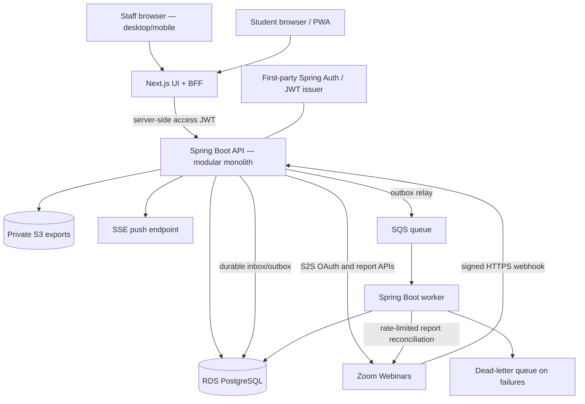
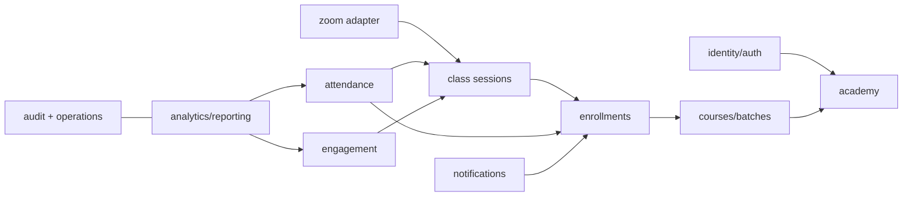
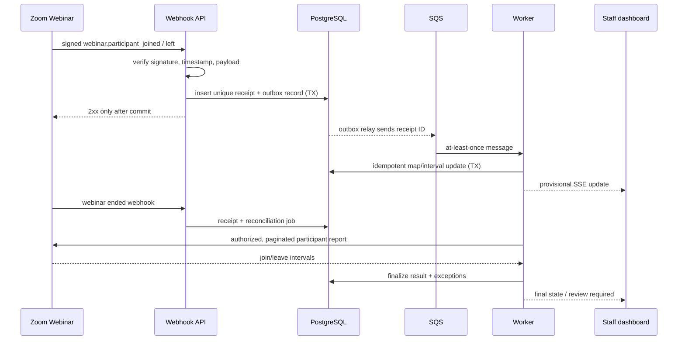
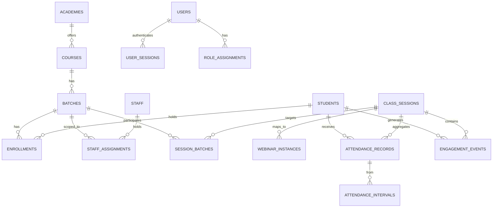

# PHYSICS CUBE ACADEMY
## Production System Architecture & Delivery Blueprint

**System:** Physics Cube — Webinar Attendance, Engagement & Academy Operations Platform  
**Product interface / design name:** LUMA — Presence Intelligence  
**Architecture decision:** **Next.js + TypeScript frontend; Java + Spring Boot modular backend; PostgreSQL; first-party JWT-based staff/student authentication; Zoom Webinars integration; durable event processing.**  
**Document:** Technical architecture, product requirements, feasibility research, data model, API contracts, security, deployment and delivery plan  
**Version:** 1.0 — **11 November 2026**  
**Classification:** Planning specification; no claim of a live production deployment or verified academy Zoom integration.  
**Existing assets:** [Editable Figma prototype](https://www.figma.com/design/QVzsewJyikM94Xp07hDwwi), academy-branded desktop and mobile designs; earlier frontend-only HTML demonstration with simulated data.

> **Evidence labels used throughout:** **CONFIRMED** = stated by the academy/team in discussion; **DECIDED** = architecture choice now accepted by the team; **RESEARCH** = supported by cited vendor/official documentation; **PROPOSED** = our design recommendation, subject to owner approval; **VALIDATE** = must be checked against the academy's actual account, policies, student population, infrastructure budget or a technical proof of concept. **Illustrative student/course data is fictional** and must never be represented as the academy's operational records.

---

# 0. Executive decision and what is changing

Physics Cube Academy has asked that a university prototype evolve into **real deployed software**, not merely a class demonstration. The academy conducts **Zoom Webinars** and already operates **multiple courses and multiple batches**. Staff currently call student names to mark attendance and check again near the end of classes. They want automated connected-time attendance, dependable student identity mapping and management reports. They additionally want student engagement indicators—including questions, polls and reactions—and monthly top-10/top-100 analyses. **[CONFIRMED]**

The team has chosen **Java Spring Boot** for the backend, wants **both staff and students to authenticate through a JWT-backed system**, and will retain the Next.js/TypeScript frontend. **[DECIDED]** We recommend **one Spring Boot modular monolith** with a separate background-worker process running the same codebase/module packages, rather than many microservices. This reduces operational risk while leaving clear boundaries for future features such as fees, assignments, LMS, parent access, additional webinar providers and eventually multiple branches or academies. **[PROPOSED]**

**The initial product must have:**

1. Secure staff and student onboarding, login, recovery, authorization, sessions and revocation.
2. Course → batch → enrollment → scheduled class → webinar occurrence → attendance/engagement relationships.
3. Authorized Zoom integration, signed webhook ingestion, durable receipts, reprocessing and post-webinar reconciliation.
4. Provisional live attendance and finalized attendance with correct total connected minutes despite disconnect/rejoin.
5. Course-, batch- and session-scoped instructor/attendance-officer dashboards with audit trails.
6. Separate engagement-source attribution for Q&A, polls and academy-owned portal reactions and learning checks.
7. Monthly reports and fair, privacy-controlled rankings.
8. Deployment, monitoring, backups, security, data policies, operational runbooks and user acceptance testing.

**Non-negotiable product boundary:** Connected minutes are evidence of a Zoom connection, **not proof of attention or learning**. Standard Zoom REST APIs do **not** establish an identifiable, reliable per-student feed for native Zoom attendee emoji reactions; native-reaction student rankings remain **experimental until independently proven**. The academy-owned student portal is the production-ready alternative for attributable reaction events. [R06][R09]

**Suggested go-live strategy:** deliver and verify attendance, identity and JWT security first; enable engagement features in a second controlled rollout. This is a production project with separate milestones and acceptance criteria; the MIS assignment's 16 November 2026 submission date is **not** a credible commitment for a fully tested production launch.

---

# 1. Business context and problem analysis

## 1.1 Known organization facts

| Fact | Evidence status | Architectural consequence |
|---|---|---|
| Organization is Physics Cube Academy | CONFIRMED by supplied academy logo and team | Own academy identity and blue/white branding |
| Uses Zoom **Webinars** for online classes | CONFIRMED | Zoom Webinar reports/events, not only Meeting endpoints |
| Has **multiple courses** | CONFIRMED | Explicit `Course` aggregate and course access filters |
| Has **multiple batches** | CONFIRMED | `Batch`, enrollments and batch-level roles from day one |
| Student attendance is taken by manual name calling near beginning and end | CONFIRMED | Automate attendance evidence and exception handling |
| Needs monthly engagement/ranking analytics | CONFIRMED | Attributable event model, aggregation and fair scoring |
| Academy now wants actual deployed, real-use software | CONFIRMED | Production security, reliability, data protection and operations required |
| Exact student counts, Zoom license, registration settings, per-class policy, budget | **UNKNOWN** | Must be agreed before capacity sizing and live integration |

## 1.2 Current-state workflow — AS IS

1. Staff schedule or open a Zoom Webinar for a class in a course/batch.
2. Students join, potentially late, with inconsistent names or unstable connectivity.
3. Staff call names and manually update their register.
4. Staff repeat a presence or engagement check near the end.
5. Attendance corrections and monthly summaries consume additional manual work.
6. Webinar-native interactions remain separate from the academy's enrollment records.

The first four items reflect the team's reported pain point. Identity errors, missing events and reconciliation effort are **risks to test**, not audited measurements of actual staff performance.

## 1.3 Problem statement

> Physics Cube Academy requires a secure, scalable, course- and batch-aware information system that reliably associates authorized Zoom Webinar participation evidence with registered students, replaces repetitive manual roll calls with transparent connected-duration attendance, supports staff review of uncertain records, and provides trustworthy attendance and participation summaries. The system must maintain appropriate privacy, authorization, auditability and operability because it will serve actual students and staff.

## 1.4 Intended business outcomes — proposed targets, not promises

| Outcome | Initial target for pilot | How to measure |
|---|---|---|
| Attendance work reduction | ≥70% less manual marking time after process adoption | Timed baseline vs pilot, same class sizes |
| Identity matching | ≥98% of correctly registered test participants automatically mapped | Match rate, manual review rate, false-match rate |
| Duration correctness | 100% of supplied synthetic interval cases pass; pilot discrepancies reviewed | Golden datasets + Zoom export comparisons |
| Webhook durability | No committed valid webhook receipt silently lost | Receipt/outbox/worker reconciliation checks |
| Monthly reporting | Generate selected monthly attendance/engagement CSV within agreed SLA | Timed export using realistic sample volume |
| Security | No cross-student or cross-batch data access in automated tests | Permission matrix tests, penetration testing |
| Production readiness | Backups, restore drill, alerts, documented rollback and academy owner acceptance | Signed go-live checklist |

---

# 2. Product scope and primary use cases

## 2.1 Academy and timetable structure — DAY-ONE REQUIREMENT

- **Academy:** one company initially; include `academy_id` in key parent objects to simplify later branches/tenancy without pretending the app is currently a SaaS product.
- **Courses:** subjects or programs, e.g., Physics / Mathematics (illustrative only).
- **Batches:** a course's cohort/cohort-period/class group; own schedule, active dates, instructors and policies.
- **Students:** one unique student profile may join many batches or courses; a student is **not** duplicated per batch.
- **Enrollments:** join student to batch with enrollment dates, status and provenance.
- **Staff assignments:** grant limited roles at academy, course or batch scope; teachers should not automatically see all students.
- **Class sessions:** unique operational occurrence with time, timezone, status and association to **one or more batches** (shared lessons must be supported).
- **Zoom webinar mappings:** connect session to Zoom scheduled ID and **specific webinar instance/occurrence UUID** where provided. Recurring webinar ID alone cannot be treated as a unique finished class.
- **Attendance and engagement:** always reference `student_id` **and** `class_session_id` (and source/instance where appropriate). Aggregates roll up to batch, course, month and academy.

**Design principle:** `Course -> Batch -> Enrollment(student, batch)` and `ClassSession <-> SessionBatch(batch, session)`. A session may serve multiple batches, and one student attending a shared session must not receive duplicated attendance for the same event.

## 2.2 User personas

| Role | Capabilities | Required restriction |
|---|---|---|
| `ACADEMY_OWNER` | Academy settings, staff provisioning, authorized reporting, integration governance | Audited high-risk actions and MFA |
| `ACADEMY_ADMIN` | Courses, batches, students, policies, Zoom mapping and staff assignment | Academy-scoped only |
| `ATTENDANCE_OFFICER` | Review queue, attendance reconciliation, corrections, scoped exports | Assigned academy/course/batch scope |
| `INSTRUCTOR` | Own class roster, attendance view, question bank, approved checks | Only assigned batches/classes |
| `ANALYST` (optional) | Permitted aggregate reports and dashboards | Avoid raw PII by default |
| `STUDENT` | Own schedule, attendance, correction requests, optional portal reactions/checks | Never read peers' private detail; leaderboard visibility by policy |
| `SYSTEM_OPERATOR` | Integration/queue/health operations | Cannot automatically see all student educational data |

A person may have multiple role assignments; students who also work for the academy can have separate contexts. Authorization must use **role + assignment scope + resource ownership**, not a role string alone.

## 2.3 Workflows in the production release

1. Admin creates courses and batches, appoints instructors and enrolls students.
2. Admin provisions students/staff by **invitation** or controlled roster import; users activate their accounts.
3. Staff create sessions, map webinars/occurrences, optionally register students through Zoom's supported flow.
4. Student authenticates to portal; attendance is measured by Zoom connection events/reports, **not simply portal login**.
5. Zoom sends signed join/leave events; staff see a clearly labeled **provisional** presence view.
6. When webinar ends, the reporting job reconciles join/leave segments and finalizes defensible attendance statuses.
7. Instructors use Q&A/poll reports where permitted, and optionally launch/approve portal engagement checks.
8. Student can view their own records and submit correction requests; staff actions are audited.
9. Monthly report jobs aggregate scoped attendance and engagement sources and produce exportable views.

## 2.4 MVP / release scope matrix

| Capability | Release | Why |
|---|---|---|
| JWT staff/student auth, roles, invites | **R1 essential** | Production security boundary |
| Courses, batches, enrollments, assignments | **R1 essential** | Already exists at academy |
| Zoom auth, signed webhook inbox, participant reports | **R1 essential** | Core automation and source-of-truth |
| Attendance calculations, exception queue, student history | **R1 essential** | Primary pain point |
| CSV attendance export, audit and policy versioning | **R1 essential** | Operational accountability |
| Q&A/poll import when available | **R2** | Additional evidence, may be permission-sensitive |
| Academy portal reactions, learning checks, monthly Top 10/100 | **R2** | Dependable attributable engagement |
| PDF analytics, opt-in notifications, AI narrative | **R2/R3** | Valuable but not critical to accurate attendance |
| Native Zoom individual emoji capture | **EXPERIMENTAL** | Attribution not established via ordinary REST API |
| Fees/payments, LMS, parent dashboard, multi-branch and multi-academy | **Future modules** | Architecture supports them; do not build prematurely |

---

# 3. Final stack and architectural rationale

| Layer | Final choice | Reason / boundary |
|---|---|---|
| Desktop/mobile web | **Next.js App Router + React + TypeScript** | Shared responsive frontend, SEO unnecessary but SSR/BFF useful |
| Visual system | **Tailwind CSS + custom shadcn/ui-based components** | Align with Physics Cube Academy navy/royal-blue/cyan/white Figma |
| Auth front-channel | **Next.js Backend-for-Frontend (BFF)** | HttpOnly cookies and server-side API proxy; avoid JS-readable token storage |
| Backend language | **Java LTS (21 baseline; consider 25 only after compatibility test)** | Team-selected ecosystem; stable and widely supported libraries |
| Backend framework | **Spring Boot supported stable at implementation** | Modular business logic, REST APIs, security, transactions, testing |
| Module architecture | **Spring Modulith conventions / modular monolith** | Modules verified for boundaries; future extraction remains optional |
| Security | **Spring Security + JWT resource-server validation + controlled token issuer** | Both staff and students use explicit roles and scoped permissions |
| Persistence | **PostgreSQL + Spring Data JPA + Flyway** | Transactional relationships, integrity, time intervals and reports |
| Zoom | **Zoom Server-to-Server OAuth, REST APIs, signed webhooks** | Academy-controlled internal account integration [R01–R05] |
| Reliable async | **PostgreSQL inbox/outbox + Amazon SQS + Spring worker + DLQ** | Durable processing, replay and rate-limited Zoom report jobs |
| Live operations UI | **SSE** (WebSocket only if later truly bidirectional) | Lightweight push for attendance dashboard; reconnect handling |
| Report files | **S3 with private access / short-lived links** | Store generated exports without exposing them publicly |
| Observability | **Spring Boot Actuator + Micrometer/OpenTelemetry + CloudWatch/Sentry** | Health, logs, metrics, traces, alerts |
| Hosting | **Next.js on Vercel or AWS, Spring API/worker on ECS Fargate, RDS PostgreSQL** | Managed services; smaller-host alternative if budget requires |
| IaC/CI/CD | **Terraform + GitHub Actions + container builds** | Reviewable, reproducible infra and deployment |
| Test stack | **JUnit 5, Testcontainers, Spring Security tests, Playwright, MSW** | Test security, DB, Zoom replay and real UI flows |

**Do not initially add:** Kafka, Kubernetes, GraphQL, independent microservices, Redis as system-of-record, ML-based attention scores, native mobile apps, or a separate Go webhook service. Each is an option only after a measured requirement appears.

## 3.1 Why Java, not Go, in this specific decision

Go would be entirely capable of implementing this backend, often with efficient concurrency and smaller processes. Java/Spring Boot is preferred here because the core roadmap is a **transactional academy business platform** (enrollment, attendance policies, corrections, permissions, reports, payments later) and Spring Security/JPA/transactions/test infrastructure provide a productive integrated foundation. Zoom networking performance is unlikely to be the decisive bottleneck; account-level Zoom API limits, idempotent event processing, registration identity and database correctness dominate. One-language backend also lowers maintenance complexity. This is an engineering preference, **not a claim that Spring is universally faster or safer than Go**.

## 3.2 Monolith boundary rule

Build one deployable **API** and one **worker** process from a shared Spring Boot repository. Each domain module may expose named application interfaces/events and must not reach directly into another module's internal repository/entity package. Use Spring Modulith verification/ArchUnit to enforce boundaries [R14]. Extract a service only for demonstrable independent scaling, compliance isolation or ownership—not because an architecture diagram looks more sophisticated.

---

# 4. Architecture diagrams

## 4.1 System context / container architecture



**Important precision:** The Spring API is also the JWT issuer and verifier; `Auth` in this diagram is an **internal module**, not a separate identity microservice. The Next.js BFF is an API-facing browser session boundary, not the primary domain backend. Zoom's S2S OAuth token is separate from academy student/staff JWTs.

## 4.2 Module dependencies



The arrows show domain dependencies, not database foreign-key ownership or runtime network calls. Reverse package dependencies are prohibited. Transactions should be owned by the module that performs the use case.

## 4.3 Attendance event sequence



## 4.4 Trust boundaries

- **Public browser:** untrusted client; authorization checked on every Spring backend request.
- **BFF:** exchanges protected cookie session for a short-lived signed JWT to call the backend; does not own academy business rules.
- **API/worker:** trusted workload identities, private DB/network, no client-supplied internal role escalation.
- **Zoom webhooks:** externally signed but still untrusted until HMAC validation, replay window checks, event schema checks and transaction commit.
- **Zoom REST:** outbound credentialed integration with rate limits and licensing dependencies.
- **SQS:** at-least-once, potentially out-of-order; workers are required to be idempotent [R12].

---

# 5. JWT authentication and authorization — complete specification

## 5.1 Key decision: two separate token systems

1. **Academy identity:** Spring Security authenticates *staff and students* and issues short-lived **academy-signed JWT access tokens**; BFF/browser session management uses HttpOnly cookies and server-side refresh coordination.
2. **Zoom identity:** Zoom Server-to-Server OAuth issues **Zoom access tokens** tied to the academy's authorized Zoom account; these authorize Zoom REST calls only and are **never** accepted as login tokens in the academy API. S2S tokens last about one hour and are obtained again with `account_credentials`; there is no S2S refresh token [R01].

Never confuse the Zoom Meeting SDK signing token (if embedding webinars later) with the academy's user JWT or Zoom's S2S API bearer token.

## 5.2 Enrollment and account creation

- **Staff accounts:** only academy owner/admin can issue an invitation specifying role and scope; email/phone verification required as appropriate. No open public staff registration.
- **Student accounts:** academy enrollment created or imported; student receives a one-time activation link or controlled activation credential, bound to **the enrolled student ID**. Avoid duplicate account creation if student joins more batches.
- **First owner bootstrap:** explicit one-time deployment/bootstrap operation guarded by environment controls, then disabled; never leave `register-admin` publicly accessible.
- **Required verification:** email or phone verification appropriate to the academy, secure password setup, password reset with single-use expiring token, revoke active sessions after sensitive reset.
- **Staff MFA:** required for owners/admins and strongly encouraged for officers/instructors (TOTP/passkey via vetted provider/library). Account recovery must be audited.
- **If students are minors:** collect and manage parental/guardian approval and communications as required by applicable policy/law; avoid unnecessary personal data.

## 5.3 Credentials and JWT contract

- Hash passwords with **Argon2id** and unique salt, or Spring-supported BCrypt if deployment/runtime constraints require it; never encrypt reversible plaintext or use SHA-256 alone for passwords [R10].
- **Access JWT:** server-signed asymmetric **RS256**, nominal 10–15-minute TTL; include `sub` (opaque user UUID), `iss`, `aud`, `iat`, `nbf`, `exp`, `jti`, `sid` (session ID), and optionally coarse role names. Include a `kid` header for rotation. Never put passwords, raw student details, Zoom secrets, DOB, email or sensitive PII inside JWT payload.
- **Validation:** Spring Security `oauth2ResourceServer().jwt()`, validate signature against trusted key, allowed algorithm, `iss`, `aud`, timestamps and account/session validity where required [R08][R09]. Never use `alg=none` or rely on browser-decoded claims.
- **Refresh token:** a **random opaque secret**, **not a long-lived JWT**, tied to a `user_session` record. Store only keyed hash in DB; rotate on every refresh. Detect reuse of the old token and revoke the entire token family / device session. Suggested idle expiry 7 days and absolute expiry 30 days—**proposed defaults**, to approve with academy.
- **Browser handling:** prefer a **Next.js BFF** keeping access/refresh credentials out of browser JavaScript and using `HttpOnly; Secure; SameSite=Lax/Strict` cookies as deployment topology permits. Do **not** put JWTs in `localStorage` or `sessionStorage` [R11]. Protect every cookie-authenticated state-changing route against CSRF (token or robust same-site/origin checks); prevent caching private responses. Use TLS everywhere.
- **Logout:** revoke server refresh/session record, clear cookies; access JWT expires quickly. For urgent account disables, check session revocation or a revocation cache for sensitive endpoints; don't claim stateless JWTs revoke themselves immediately.
- **Key lifecycle:** signing private keys stored in Secrets Manager/KMS-controlled environment, separate dev/stage/prod keys, rotate with overlapping public-key availability, retire leaked keys and invalidate sessions on incident.

**Example JWT claims (illustrative, NOT a usable token):**

```json
{
  "iss": "https://auth.physicscube.example",
  "aud": "physics-cube-api",
  "sub": "user-uuid",
  "sid": "session-uuid",
  "jti": "token-uuid",
  "roles": ["INSTRUCTOR"],
  "iat": 1794400000,
  "nbf": 1794400000,
  "exp": 1794400900
}
```

Store `academy_id`/assignment scopes in authoritative DB records or a carefully versioned claim; **always** load/verify resource membership when authorizing student/batch-level requests. JWT signature verification alone does not prove a staff member has access to *this* batch.

## 5.4 Auth API endpoints

| Method | Route | Who | Action / requirements |
|---|---|---|---|
| `POST` | `/api/v1/auth/activate` | invited user | One-time invite token, password setup and verification |
| `POST` | `/api/v1/auth/login` | public with throttling | Credentials; issue short-lived access and rotating refresh session through BFF |
| `POST` | `/api/v1/auth/refresh` | session holder | Rotate refresh, issue access JWT, detect replay |
| `POST` | `/api/v1/auth/logout` | authenticated | Revoke current refresh session, clear browser session |
| `POST` | `/api/v1/auth/logout-all` | authenticated | Revoke all sessions (recent re-authentication required) |
| `POST` | `/api/v1/auth/forgot-password` | public | Rate-limited generic response; no account enumeration |
| `POST` | `/api/v1/auth/reset-password` | reset token | One-time expiry, reset hash, revoke sessions |
| `POST` | `/api/v1/auth/mfa/verify` | step-up user | MFA challenge/response where enabled |
| `GET` | `/api/v1/auth/me` | authenticated | Return current user and assigned scopes from DB |
| `GET` | `/api/v1/auth/sessions` | authenticated | Device/session listing, revocation controls |
| `POST` | `/api/v1/admin/invitations` | scoped owner/admin | Invite staff/student; privilege checks |

**Abuse defenses:** rate-limit login and recovery per account/IP with safe thresholds, lockout/backoff, generic login errors, credential-stuffing monitoring, session-fixation protection, MFA recovery controls, audit of role changes, HTTPS/HSTS, secure CORS, dependency/SCA scanning and an independent security review.

## 5.5 Authorization matrix

| Operation | Owner / Admin | Attendance officer | Instructor | Student |
|---|---|---|---|---|
| Manage courses and batches | Yes / as delegated | No | Read assigned | Read enrolled |
| Invite staff / change roles | Yes | No | No | No |
| Enroll student | Yes | Delegated | No by default | No |
| View a batch's attendance | All authorized | Assigned | Assigned | **Only self** |
| Correct attendance record | With audit | Assigned with reason | Propose only by default | Request review |
| View monthly individual engagement ranking | Authorized | Assigned / policy | Assigned / policy | No peers by default |
| Create engagement check | Yes | Optional | Own batch | No |
| Respond to portal check | No | No | No | Own enrolled session |
| Configure Zoom secret | Zoom/system admin | No | No | No |
| Download raw student export | Explicit restricted right | Assigned and approved | Restricted | Own data only |

**Critical tests:** IDOR on `/students/{id}`, `/batches/{id}`, `/reports?batch=...`; course/batch cross-access; user disabled with unexpired JWT; forged JWT, modified `kid`/algorithm; replayed refresh; CSRF on cookie BFF routes; invitation reuse; staff user impersonation; report-download URL expiration.

---

# 6. Course, batch, enrollment and session domain model

## 6.1 Domain relationships



**Normalization rules:** `students.user_id` optional until activation; student profile stays stable across years; batch names unique only within course/academic term where appropriate; `session_batches` unique `(class_session_id,batch_id)`; `enrollments` can have history/status; unique final attendance `(student_id,class_session_id)` regardless of shared batch mapping; multiple Zoom instances on a session only if explicitly supported/recorded.

## 6.2 Core data dictionary

| Entity / table | Important columns | Constraints / notes |
|---|---|---|
| `academies` | `id`, `name`, `timezone`, `status` | One academy now; prepare for multi-branch later |
| `users` | `id`, `login_identifier`, `password_hash`, `status`, `verified_at` | Never store raw password |
| `user_sessions` | `id`, `user_id`, `refresh_hash`, `family_id`, `expires_at`, `revoked_at`, `device_meta` | Refresh token rotation and reuse detection |
| `role_assignments` | `user_id`, `role`, `academy_id`, `course_id?`, `batch_id?`, `status` | Backend authorization checks |
| `students` | `id`, `academy_id`, `student_code`, `user_id?`, `name`, `contact`, `status` | Unique academy student code |
| `staff` | `id`, `academy_id`, `user_id`, `position`, `status` | Separate employment profile |
| `courses` | `id`, `academy_id`, `code`, `title`, `active` | Historical courses not hard deleted |
| `batches` | `id`, `course_id`, `code`, `academic_year`, `start`, `end`, `status` | Many batches per course |
| `enrollments` | `id`, `student_id`, `batch_id`, `joined_at`, `left_at`, `status` | Many-to-many with status history |
| `staff_assignments` | `id`, `staff_id`, `batch_id`, `role`, `valid_from/to` | Scope controls |
| `class_sessions` | `id`, `academy_id`, `title`, `starts_at_utc`, `ends_at_utc`, `status`, `policy_version` | One scheduled teaching occurrence |
| `session_batches` | `class_session_id`, `batch_id` | Supports shared cross-batch lessons |
| `webinar_instances` | `id`, `class_session_id`, `zoom_webinar_id`, `zoom_uuid`, `occurrence_id?`, `state` | UUID unique when present |
| `webinar_registrations` | `id`, `webinar_instance_id`, `student_id`, `registrant_id?`, `email_hash?`, `join_token_ref?` | Sensitive join URLs protected; no public export |
| `zoom_webhook_receipts` | `id`, `dedupe_key`, `event_type`, `received_at`, `payload_ref`, `processed_at`, `status` | Unique dedupe; storage policy |
| `outbox_events` | `id`, `type`, `aggregate_id`, `published_at`, `retries` | Transactional relay |
| `attendance_intervals` | `id`, `student_id?`, `session_id`, `source_event_id`, `join_at`, `leave_at?`, `quality` | Preserve provenance, incomplete segments |
| `attendance_records` | `student_id`, `session_id`, `connected_seconds`, `ratio`, `status`, `finalized_at`, `version` | Unique student + session; version for concurrency |
| `attendance_overrides` | `attendance_id`, `before`, `after`, `actor_user_id`, `reason`, `time` | Append-only audited corrections |
| `engagement_events` | `id`, `student_id?`, `session_id`, `source`, `kind`, `created_at`, `metadata` | Source and identity confidence required |
| `pulse_questions`, `pulse_sessions`, `pulse_responses` | prompt, teacher approval, session trigger, student answer/time | Controlled release, accessible student portal |
| `report_jobs` | filters, creator, status, object_key, generated_at, expiry | Private exports, job progress |
| `audit_events` | actor, action, resource, before/after summary, request_id, timestamp | Retention and tamper protection |
| `policy_versions` | scope, effective_from, threshold, exceptions, approver | No retroactive silent changes |

**Indexes to plan:** `class_sessions(academy_id,starts_at_utc)`, `enrollments(batch_id,status)`, `staff_assignments(staff_id,batch_id)`, `webinar_instances(zoom_uuid)`, `zoom_webhook_receipts(dedupe_key UNIQUE)`, `attendance_records(session_id,student_id UNIQUE)`, `engagement_events(session_id,student_id,source,created_at)`, `report_jobs(academy_id,status)`. Validate with `EXPLAIN ANALYZE` after representative volume is known.

## 6.3 Policy hierarchy

`Academy default -> Course override -> Batch override -> Session snapshot`. Resolve a **policy version at session creation/start**, then store the effective rule on the class/attendance calculation; later policy edits should not silently rewrite previous final results. Approval required for retrospective recalculation, producing a new version/audit event.

## 6.4 Attendance status model

- `SCHEDULED`: not started.
- `PROVISIONAL`: webinar in progress; may be incomplete.
- `REPORT_PENDING`: webinar ended, Zoom report not yet reconciled.
- `PRESENT` / `BELOW_THRESHOLD` / `ABSENT`: finalized after source coverage and policy calculation; never infer absent from *missing data alone*.
- `NEEDS_REVIEW`: ambiguous identity, incomplete interval, Zoom mismatch, report delay or policy exception.
- `EXCUSED`: staff-authorized reason, audited.
- `CORRECTED`: retain original computed result and explicit override metadata; user-facing status may display corrected outcome.

---

# 7. Zoom Webinar integration — supported capabilities and limits

## 7.1 Authorization and account ownership

**[RESEARCH]** Zoom supports **Server-to-Server OAuth** for an internal backend integration to an account the academy controls. Admin/role permissions are needed to create/activate the app and grant appropriate scopes [R01][R02]. The backend requests Zoom OAuth tokens with account credentials, uses them only for Zoom API calls and stores secrets outside source control. No routine user-facing OAuth consent per academy student is necessary for the **account-level S2S REST integration**, but this does **not** authorize collecting arbitrary data outside the academy's account, and privacy/notice requirements still apply.

**[VALIDATE]** Before development commitments, inspect the actual academy Zoom plan (Webinar vs Webinars Plus), host/user permissions, attendee registration/authentication rules, required scopes, sample report fields and applicable event subscriptions. The live app scope picker is authoritative; don't freeze unverified scopes as contractual facts.

## 7.2 Feasibility matrix

| Capability | Assessment | Constraints and test |
|---|---|---|
| Join and leave webinar events | **Documented** | Webhook subscription, signing verification, attendee identity may vary [R03] |
| Attendance post-webinar reports | **Documented** | Eligible paid plan/add-on, scopes, lookback, page through results [R04] |
| Rejoin intervals / total duration | **Computable** | Correct matching, deduplication and reconciliation in our backend |
| Webinar Q&A data | **Available in appropriate reports** | Licensing/scopes, identity and Q&A settings, source attribution [R04] |
| Poll report results | **Documented** | Anonymous answers cannot be ranked by student ID [R04] |
| Create webinar polls via REST | **Documented** | Doesn't imply automated launch of live native polls |
| Random native Zoom poll *launch* via public REST | **Not established by reviewed REST docs** | Instructor may launch prepared polls; optional SDK proof of concept |
| Native Zoom attendee emoji per student | **Not dependable as a guaranteed API feature** | Meeting SDK references anonymous attendee reactions [R06]; Zoom Apps SDK requires controlled experiment [R07] |
| Academy portal emoji per student | **Fully controllable in our app** | Authenticated student ID, consent, rate limits, analytics semantics |
| Zoom "attention tracking" / gaze detection | **Do not propose** | No defensible evidence that connection or reactions prove attention |

## 7.3 Webhook receiver contract

**Endpoint:** `POST /api/v1/integrations/zoom/webhook` — public inbound HTTPS, no academy JWT required because Zoom is not an academy user. Instead, validate Zoom's signed headers and event payload using the app's webhook secret, raw request bytes, timestamp freshness and replay defenses [R05]. Support endpoint challenge/URL validation as required by Zoom. Restrict body size and content types, never log access credentials or whole payloads in default logs.

**Correct critical path:** verify → begin DB transaction → insert uniquely keyed receipt plus outbox row → commit → return 2xx quickly. If storage fails, respond with a retryable failure per Zoom expectations; if duplicate, return 2xx after verifying signature (idempotency). Relay outbox receipt IDs to SQS asynchronously. Worker acknowledges a queue delivery **only after** idempotent business transaction commits. SQS Standard can redeliver and reorder [R12]; never assume strict arrival order.

## 7.4 Deduplication and ordering

- Prefer a stable Zoom event identifier when available and trustworthy; otherwise derive a deterministic key from account, event type, webinar UUID, participant identifier and event timestamp/payload hash, recording collision risk. Do **not** use display name as an event key.
- Store raw receipt and processing outcomes, with a unique receipt boundary and independent business idempotency keys.
- Do not treat `participant_left` arriving first as impossible; hold unresolved events for later matching.
- Protect concurrent processing by unique DB constraints, row locking/optimistic versioning and transaction tests.
- Schedule post-webinar report reconciliation; retry `429` with exponential backoff and respect account quotas [R13].
- Keep webhook event source and report source distinct; field-level discrepancies create review or quality flags, not silent overwrites.

## 7.5 Webinar occurrence identity

Zoom may have recurring webinar schedules and specific occurrence IDs/UUIDs. `class_sessions.id` is **our** authoritative scheduled class key. Preserve `zoom_webinar_id`, `zoom_uuid` (finished instance), `occurrence_id` where supplied and timestamps with provenance. Staff must explicitly map or confirm ambiguous Zoom webinar occurrences. Avoid concatenating a number and date and treating it as unique without reconciliation.

## 7.6 Student identity mapping hierarchy

1. Academy enrollment identity `student_id` is authoritative.
2. Prefer unique and approved Zoom registrant ID / registrant token linked to enrollment if available.
3. Use verified account/email mapping only under approved registration rules and privacy notice.
4. Use display name as a **suggestion for manual review only**; it is not a reliable key.
5. On ambiguity, mark `NEEDS_REVIEW`, preserve original evidence, let authorized staff resolve and audit.

Multiple devices may produce overlapping intervals. One registered student attending a shared session is one attendance record; duplicate accounts/device joins must not inflate connected minutes.

## 7.7 Session reconciliation algorithm

1. Load class session and permitted Zoom occurrence(s), finalized status and policy snapshot.
2. Obtain official participant report with pagination/retry, normalized UTC timestamps and capture run ID.
3. Resolve the Zoom participant/registrant to a student or mark unmatched for manual review.
4. Normalize interval endpoints to `[join, leave)`; discard or quarantine nonsensical inverted intervals, do not invent missing leaves.
5. Clip to the authorized attendance window (policy-defined grace rules; **do not assume** all class time is credited).
6. Sort intervals by join and merge overlap or adjacency within explicit, approved tolerance.
7. Compute union duration; cap by eligible class duration. `attendance_ratio = connected_seconds / eligible_class_seconds` when denominator >0.
8. Apply the **versioned** batch/course/session policy; status may remain review pending if identity or source quality is uncertain.
9. Persist attendance record, interval provenance, reconciliation version and quality flags transactionally.
10. Publish the revised view and notify staff of exceptions; later reports/appeals create new audit records rather than destroying prior evidence.

**Worked example:** 14:00–14:45 (45 minutes), rejoin 14:50–15:35 (45 minutes), duplicate device 15:20–15:55 (35 minutes). After merging overlap, the union is 14:00–14:45 (45 min) and 14:50–15:55 (65 min) = **110 minutes**, not 125. For a scheduled 120-minute class, ratio is **91.67%** if that is the academy-approved denominator. The exact threshold and credit window are **VALIDATE** items.

## 7.8 Report availability and operational mode

Zoom participant report access is documented for eligible plans with a webinar add-on, and there are reporting lookback limitations [R04]. Schedule report retrieval shortly after session completion, retry delayed report generation, preserve report import time and quality. Keep a **supervised CSV import** fallback for authorized Zoom exports if API access is temporarily unavailable; mark results as `IMPORTED` and require staff reconciliation. Never show an import as "live".

---

# 8. Engagement: accurate, attributable, fair

## 8.1 Separate engagement sources

`engagement_events.source` must be one of `ZOOM_QA`, `ZOOM_POLL`, `ACADEMY_REACTION`, `ACADEMY_PULSE_CHECK`, `INSTRUCTOR_NOTE` (if approved) or future integration-specific sources. Each has `attribution_status` (`VERIFIED_STUDENT`, `ANONYMOUS_AGGREGATE`, `UNRESOLVED`) and `source_event_id` for deduplication. Native Zoom attendee emoji events must **not** be silently labeled as identified student reactions.

## 8.2 Reaction tracking decision

**Production recommendation:** implement the **academy-owned student engagement portal** with identified ❤️/👍/👏/🙋 interactions, explicit UX copy, per-student/day/session rate limits, abuse monitoring, optional opt-out and no requirement that clicks prove attention.

**Optional research spike:** evaluate a host-side Zoom App/SDK in a real academy Webinar. Compare test participants' emoji events, participant UUIDs, roles, timing, host app open state and consistency against ground truth. Zoom Meeting SDK documents anonymous webinar attendee reaction callbacks, while Zoom Apps SDK types expose participant UUID fields; do not assume they have the same permissions/identity semantics [R06][R07]. Go/no-go requires written permissions, complete delivery, stable lawful identity match and acceptable privacy handling. Do not promise this in the sales contract until verified.

## 8.3 Pulse question delivery

- Instructors prepare question banks and approve low-stakes prompts before class.
- Student portal offers scheduled/randomized prompts **within our own app**, not as forced native Zoom webinar popups.
- Store session ID, student ID, question version, delivery timestamp, response timestamp, answer and event provenance.
- Handle poor connectivity: late response, absence from portal and accessibility needs are not automatically treated as truancy.
- Students may respond from mobile while webinar plays elsewhere; platform should be transparent about second-screen requirement.
- Separate factual correctness, participation presence and attendance connection time; never conflate scores.

## 8.4 Monthly top 10 / top 100 reporting

Default *private manager view*: raw verified reactions, distinct sessions with participation, Q&A count, pulse-check response rate, attendance percent and `events_per_attended_class` side-by-side. For a fair comparison, consider unique participation opportunities and cap repeated rapid tapping. Normalize by attended sessions; display ranking methodology and data quality. Student-facing peer rankings must be explicit policy/consent and appropriate for minors.

**Sample report SQL (illustrative):**

```sql
SELECT s.id, s.student_code, COUNT(*) AS portal_reaction_count,
       COUNT(DISTINCT e.class_session_id) AS classes_with_reactions
FROM engagement_events e
JOIN students s ON s.id = e.student_id
JOIN class_sessions cs ON cs.id = e.class_session_id
WHERE e.source = 'ACADEMY_REACTION'
  AND e.attribution_status = 'VERIFIED_STUDENT'
  AND cs.starts_at_utc >= :month_start
  AND cs.starts_at_utc < :next_month_start
  AND EXISTS (
    SELECT 1 FROM session_batches sb
    JOIN enrollments en ON en.batch_id = sb.batch_id
    WHERE sb.class_session_id = cs.id
      AND sb.batch_id = :authorized_batch_id
      AND en.student_id = s.id
  )
GROUP BY s.id, s.student_code
ORDER BY portal_reaction_count DESC, classes_with_reactions DESC, s.id
LIMIT 100;
```

**Implementation note:** The `EXISTS` filter tests batch membership without multiplying engagement rows when a session is shared across batches. Still enforce scope-approved batch access in the backend and add tests for unusual enrollment history, duplicate event IDs and cross-batch report permissions.

## 8.5 AI analysis — optional bounded module

If requested and contractually approved, generate manager-reviewed summaries only from validated aggregate metrics (e.g., "late joins increased in Batch B"), with confidence/data-quality notes and source links. Use data minimization, privacy review, human approval, prompt-injection defenses and no automated high-stakes educational judgments or speculative "attention" claims. No AI needed to calculate duration, authenticate users or enforce attendance policy.

---

# 9. API design: initial REST contract

**Conventions:** `/api/v1` version prefix, JSON, RFC 9457 Problem Details for errors, pagination on collections, UTC ISO 8601 timestamps, cursor pagination for growing event lists, client-visible request/correlation ID, stable IDs, no internal stack traces. `academy_id` is not trusted just because supplied in the URL—derive authorized scope from user/assignment. Use idempotency keys for commands where duplicate HTTP calls are dangerous.

| Method | Path | Role/scope | Purpose |
|---|---|---|---|
| `GET` | `/me` | All authenticated | Profile, current role and permitted contexts |
| `GET/POST` | `/courses` | Scoped admin | List/create academy courses |
| `GET/PATCH` | `/courses/{courseId}` | Scoped admin/instructor read | Course detail/update |
| `GET/POST` | `/courses/{courseId}/batches` | Scoped admin | List/create batches |
| `GET/PATCH` | `/batches/{batchId}` | Scoped staff | Batch details |
| `GET/POST` | `/batches/{batchId}/enrollments` | Scoped staff | Roster and enrollment import |
| `GET` | `/students/{studentId}` | Scoped staff or **same student** | Student detail |
| `GET` | `/students/{studentId}/attendance` | Scoped staff or same student | Own/authorized history |
| `POST` | `/staff/assignments` | Admin | Bind instructor/officer to batch |
| `GET/POST` | `/class-sessions` | Scoped staff | Sessions with batch mappings |
| `POST` | `/class-sessions/{id}/webinar-link` | Admin/staff with permission | Map scheduled Zoom Webinar instance |
| `GET` | `/class-sessions/{id}/attendance` | Assigned staff | Provisional/final roster and confidence |
| `GET` | `/class-sessions/{id}/live` | Assigned staff | SSE stream or signed channel token |
| `POST` | `/class-sessions/{id}/reconcile` | Authorized staff | Request idempotent reconciliation job |
| `GET` | `/attendance/exceptions` | Assigned officer | Review queue with status/filters |
| `POST` | `/attendance/{recordId}/corrections` | Assigned officer/admin | Reasoned immutable correction |
| `POST` | `/attendance/{recordId}/appeals` | Owning student | Correction request, not direct override |
| `GET/POST` | `/pulse/questions` | Assigned instructors | Question bank and versioning |
| `POST` | `/pulse/sessions/{id}/responses` | Enrolled student | Submit response idempotently |
| `POST` | `/engagement/reactions` | Enrolled student | Record portal reaction with rate limits |
| `GET` | `/reports/attendance` | Authorized staff | Filtered aggregate summaries |
| `GET` | `/reports/engagement` | Authorized staff | Source-separated metrics |
| `GET` | `/reports/leaderboard?top=10` | Authorized staff | Top 10/100 and methodology |
| `POST` | `/report-jobs` | Authorized staff | Async private CSV/PDF generation |
| `GET` | `/report-jobs/{id}` | Request owner/admin | Status + short-lived authorized URL |
| `POST` | `/integrations/zoom/webhook` | Zoom signature only | Verification and receipt commit |
| `GET` | `/integrations/zoom/status` | Integrations admin | Scope/health/last-sync (no secrets) |
| `GET` | `/operations/health` | Monitors | Readiness/liveness, protected details |

**API examples:**

```http
GET /api/v1/class-sessions/56d.../attendance
Authorization: Bearer <short-lived-academy-access-jwt>
```

```json
{
  "classSessionId": "session-uuid",
  "state": "REPORT_PENDING",
  "sourceQuality": "PARTIAL_LIVE_WEBHOOKS",
  "effectivePolicy": {"minConnectedRatio": 0.75, "version": 3},
  "records": [
    {"studentId": "student-uuid", "connectedSeconds": 6600,
     "attendanceRatio": 0.9167, "status": "PROVISIONAL",
     "reconciliationStatus": "WAITING_FOR_OFFICIAL_REPORT"}
  ]
}
```

**Authorization exception:** a public webhook route is not exposed through user JWT auth; its Zoom HMAC validation is its authentication mechanism. System-to-system worker endpoints should use workload identity/private networking, not unrestricted public JWT endpoints.

---

# 10. Frontend experience and existing assets

**Brand palette derived from supplied academy logo:** Navy `#22206A`, academy blue `#1B65A2`, cyan `#22B5E2`, white `#FFFFFF`, pale blue `#F2F8FD`. Maintain accessible contrast: cyan should primarily be an accent, not small white text on cyan; use dark-navy text when needed. Colors are visual references and can be refined by academy approval.

**Current artifacts:** [Figma design](https://www.figma.com/design/QVzsewJyikM94Xp07hDwwi) has 12 desktop and 12 mobile screens in the blue/white palette, covering operations, live room, attendance, student profile, engagement, pulse studio, rankings, reports, review, mappings, Zoom integration and settings, plus staff/student mobile experiences. A frontend-only HTML/ZIP demo was built with fictional records and simulated Zoom events. **Neither artifact is evidence of a deployed, API-connected product.**

**Target Next.js areas:**

- `(auth)`: invite activation, login, MFA, forgot/reset password, sessions.
- `(staff)`: overview, courses, batches, calendar, roster, live monitor, ledger, review queue, identity mapping, engagement, report jobs, policies, integration health.
- `(student)`: own schedule, joined classes, attendance details, correction requests, portal reactions, pulse checks, profile and privacy.
- BFF routes: browser cookie handling, safe authenticated proxy, CSRF and error normalization.
- Responsive UI: true mobile layout, not desktop content hidden by CSS; PWA shell optional after basic behavior is stable.

**Accessibility:** keyboard navigation, sufficient contrast, error announcements, accessible charts/tabular alternatives, readable mobile typography, reduced-motion support, low-bandwidth modes and no color-only status distinctions. User journey tests must cover invite → login → enrolled course → upcoming webinar → attendance history and staff → batch → webinar → review → export.

---

# 11. Production deployment and infrastructure

## 11.1 Target topology

```mermaid
flowchart TB
  Internet[Internet / browsers] --> WAF[DNS + TLS + optional AWS WAF/CDN]
  WAF --> V[Next.js frontend / BFF (Vercel or AWS)]
  V --> ALB[Public HTTPS Application Load Balancer]
  Zoom[Zoom public webhook source] --> ALB
  ALB --> API[ECS Fargate Spring API, private subnet]
  API --> DB[(RDS PostgreSQL, private subnets)]
  API --> SQS[SQS queue + DLQ]
  SQS --> WK[ECS Fargate Spring worker]
  WK --> DB
  API --> S3[(Private S3)]
  API --> SM[Secrets Manager / KMS]
  WK --> SM
  API --> CW[CloudWatch / telemetry]
  WK --> CW
```

Choose AWS Region based on latency, budget, legal/data residency obligations and academy policy. Avoid assuming "Sri Lanka must host data locally" without legal review. Use separate **dev**, **staging** and **production** environments with distinct secrets/DBs. Vercel frontend is optional; AWS-hosted frontend can simplify single-cloud operations when preferred.

## 11.2 Infrastructure components

| Component | Initial purpose | Key hardening |
|---|---|---|
| Container registry | Versioned API/worker images | Image scanning, digest pinning |
| ECS Fargate API | Public REST behind ALB | Task IAM, autoscaling, readiness, private DB route |
| ECS Fargate worker | Queue consumers and scheduled report jobs | No public ingress, bounded concurrency |
| RDS PostgreSQL | Strongly consistent business data | Encryption, private SG, backups, PITR, migration discipline |
| SQS + DLQ | Durable asynchronous events | Queue policies, visibility timeout, replay tooling, alerts |
| S3 | Exports and sanitized import files | Private bucket, encryption, expiry lifecycle, presigned URLs |
| Secrets Manager/KMS | Zoom app credentials, JWT signing key, DB credentials | IAM-scoped access, rotation, never logs |
| ALB / DNS / ACM | TLS/API/webhook ingress | HTTPS, request size/rate limits, WAF when justified |
| CloudWatch/OTel | Health, job failures, webhook lag, audit metrics | Redact PII; security alerts |
| GitHub Actions | Tests, SCA, container publishing, deploy | AWS OIDC; protected branches/approval |
| Terraform | Versioned infrastructure | Separate state, policy checks, reviewable plans |

**Budget caution:** managed NAT, ALB, RDS and always-on ECS tasks can dominate costs for a small academy. The proposed AWS topology is the full production target; benchmark an initial lower-cost managed host + PostgreSQL + durable queue before committing. Don't invent a rupee/month quote without region, class concurrency, uptime goals and storage demand.

## 11.3 Operational availability and disaster recovery

**Proposed objectives to validate:** 99.5% monthly API availability initially, no silent lost signed webhook receipts, provisional data typically visible within 5–15 seconds **under measured normal load**, report reconciliation within a target such as 30 minutes after Zoom report becomes available (subject to vendor delays), daily encrypted backups with point-in-time recovery, example RPO ≤15 minutes and RTO ≤4 hours **only after infrastructure testing**. A target is not a guaranteed SLA. Conduct a full backup restore in staging and document manual fallback attendance procedure.

For a low-cost launch, it's acceptable to begin with a single API task plus one worker and managed DB if the academy accepts the resulting availability risk. For higher availability, use multiple API tasks across zones, suitable RDS Multi-AZ and private networking.

---

# 12. Repository structure and architecture enforcement

```text
physics-cube/
├── apps/
│   └── web/                         # Next.js + TypeScript + Tailwind
│       ├── app/(auth)/
│       ├── app/(staff)/
│       ├── app/(student)/
│       ├── app/api/                 # BFF, not core business logic
│       ├── components/
│       ├── lib/api-client/
│       └── tests/e2e/
├── backend/
│   ├── pom.xml                      # Java LTS, Spring Boot, Modulith
│   ├── src/main/java/com/physicscube/
│   │   ├── identity/               # credentials, JWT, refresh sessions
│   │   ├── academy/                # academy settings
│   │   ├── catalog/                # courses and batches
│   │   ├── enrollment/             # student membership
│   │   ├── scheduling/             # class sessions and mappings
│   │   ├── zoomintegration/        # Zoom adapter and verified receipt inbox
│   │   ├── attendance/             # intervals, policies, corrections
│   │   ├── engagement/             # Q&A/polls/portal reactions/pulse
│   │   ├── analytics/              # reporting + rankings
│   │   ├── notification/           # emails, optional push later
│   │   ├── auditing/               # append-only audit use cases
│   │   ├── operations/             # readiness and runbooks
│   │   └── shared/                 # narrow cross-module primitives
│   ├── src/main/resources/db/migration/
│   ├── src/test/
│   └── src/integrationTest/
├── infrastructure/
│   ├── terraform/
│   ├── environments/dev/
│   ├── environments/staging/
│   └── environments/prod/
├── docs/
│   ├── decisions/
│   ├── api/openapi.yaml
│   ├── runbooks/
│   ├── threat-model.md
│   └── privacy-retention.md
├── docker-compose.yml              # local PostgreSQL + optional queue emulator
└── .github/workflows/
```

**Code quality rules:** module API boundaries; validation on request DTOs; domain services for attendance calculations; persistence transactions in application layer; no credentials in config files; JSON logs with correlation IDs and redaction; API schema under source control; database migrations reviewed; never commit real student exports. Use MapStruct/records where appropriate without making frameworks the business domain.

---

# 13. Testing and quality strategy

## 13.1 Test pyramid

| Layer | What to prove | Tools |
|---|---|---|
| Domain unit | Interval union, threshold rules, scoring, permission policy functions | JUnit 5, AssertJ |
| Security | JWT claims, expired/bad signature, refresh reuse, role/scope/IDOR, CSRF | Spring Security Test, integration HTTP tests |
| DB integration | Flyway schema, constraints, unique receipts, transactional outbox, concurrent idempotency | Testcontainers PostgreSQL |
| Queue integration | At-least-once redelivery, out-of-order, retries, DLQ, replay | LocalStack/Testcontainers or AWS staging |
| Contract | Zoom fixture schemas (sanitized), webhook signature and URL challenge | Recorded documented fixtures + adapters |
| Backend HTTP | REST status codes, pagination, problem details, exports | SpringBootTest + MockMvc/RestAssured |
| Frontend | Responsive flows, controls, accessibility, staff/student routes | Playwright + axe |
| Operational | RDS restore, migrations, rate limits, forced instance kill, queue failure | Staging drills |
| Academy UAT | Staff enters course/batches, reviews one class, student accesses own data | Signed UAT scripts |

## 13.2 Mandatory acceptance scenarios

- **A01** Admin creates two courses and 4 batches, assigns instructor to only one batch.
- **A02** Student is enrolled in two batches; only one account/profile exists.
- **A03** A shared session includes two batches; one student's attendance appears only once per session.
- **A04** Staff in Batch A cannot read Batch B reports, even by changing URL IDs.
- **A05** Student cannot read another student's attendance.
- **A06** Expired/forged JWT rejected; disabled user cannot continue sensitive operations.
- **A07** Refresh token rotates; reuse of an old token invalidates session family.
- **A08** Valid Zoom HMAC challenge and signed event accepted; invalid/replayed signatures rejected.
- **A09** Duplicate join/leave delivery creates one effective business outcome.
- **A10** Concurrent identical webhook deliveries do not duplicate receipt or interval effect.
- **A11** `leave` arrives before `join`; later reconciliation produces correct duration or review state.
- **A12** Three reconnect intervals, including overlap, produce union not sum of raw durations.
- **A13** Same webinar scheduled ID with two distinct Zoom occurrences maps to different classes correctly.
- **A14** Report unavailable/429 transitions to retry and preserves `REPORT_PENDING` state.
- **A15** Unmatched name does not automatically get assigned to similar student.
- **A16** Manual correction captures actor, reason and before/after and is reversible/audited.
- **A17** Student portal reaction is linked to verified enrollment and rate-limited.
- **A18** Unknown/anonymous Zoom poll event cannot create identified reaction score.
- **A19** Top 10 vs Top 100 applies correct batch and month filters and no shared-session double count.
- **A20** CSV export excludes unauthorized student PII and uses formula-injection-safe escaping.
- **A21** Backup/restore drill and deploy rollback succeed in staging.
- **A22** Mobile student check remains usable with keyboard/screen reader and slow network.
- **A23** Logout-all invalidates refresh sessions and sensitive access despite an earlier access JWT.
- **A24** Malicious/unauthorized report URL sharing fails after link expiry or outside requester scope.

**Go-live gate:** security checks, Zoom account POC and representative reconciliation comparisons must pass. Screenshots and demo HTML alone do **not** satisfy this gate.

---

# 14. Delivery roadmap, dependencies and responsibilities

The dates below are **sequencing recommendations**, not estimates or delivery promises. The first limited real-student pilot must occur only after the necessary academy approvals, security testing and data-protection review.

| Phase | Deliverables | Exit criterion |
|---|---|---|
| 0 — Discovery + contract | Confirm academy stakeholders, Zoom license, capacity, budget, legal/privacy, requirements, pilot cohort | Written scope, permissions and acceptance rules approved |
| 1 — Engineering foundation | Monorepo, Next.js shell, Spring Boot modules, PostgreSQL/Flyway, Docker, CI, staging | Test+build+deploy pipeline green |
| 2 — JWT and users | Invites, student/staff accounts, secure login, refresh, MFA for admins, RBAC/ABAC, recovery | Security tests and onboarding UAT pass |
| 3 — Course/batch domain | Courses, batches, enrollments, staff assignments, class sessions, policy versions | Shared-session/multi-batch test pass |
| 4 — Zoom feasibility spike | Private S2S app, signed webhook, sample authorized reports, registration mapping | Approved real-account evidence and POC results |
| 5 — Attendance engine | Durable receipts/outbox/queue worker, interval union, reconciliation, exception queue, SSE | Golden interval cases, replay and reconciliation pilot pass |
| 6 — Reports and student views | Monthly attendance, CSV/PDF, student history/appeals, audit exports | UAT and privacy scope checks pass |
| 7 — Engagement | Portal reactions, Q&A/polls where licensed, pulse studio, top 10/100 | Verified attribution, fair scoring and consent review |
| 8 — Production rollout | Backups, alerts, security/load tests, training, manual fallback, owner signoff | Controlled pilot -> monitored rollout -> handover |
| 9 — Growth | LMS, payments, parents, more providers, branches, AI summaries | Separate business justification and ADR per feature |

## 14.1 Suggested workstreams

- **Product / stakeholder lead:** academy interviews, acceptance criteria, policy/consent decisions, UAT coordination.
- **Backend/auth lead:** Spring Security, JWT refresh, role/scope policy, student identity and module contracts.
- **Zoom/data lead:** webhooks, receipts, API reports, idempotency, reconciliation, participant identity.
- **Frontend lead:** Next.js migration from HTML mock to real APIs, accessible desktop/student views.
- **Cloud/QA lead:** PostgreSQL, Terraform, CI/CD, container deployment, observability, tests, backups.

One person may take multiple roles, but **security and attendance correctness need peer review**.

## 14.2 Dependency and critical path

Confirmed Zoom license/permissions → student registration identity POC → webhook + official report samples → attendance reconciliation acceptance → real-student pilot. In parallel, build auth, course/batch model, UI and synthetic event tests. Do not block all frontend work on live credentials, but do not claim production correctness without them.

---

# 15. Security, privacy and responsible use

## 15.1 Personal information and academy ownership

Student IDs, name/contact information, attendance intervals, class registration and participation events are personal data. Physics Cube Academy must approve which fields are collected, for what purpose, how long they are kept, who can access them, how students correct errors, and what happens when a student leaves. **Do not publicly publish identified leaderboards or individual attendance details by default**. Access/export actions need audit trails, especially when minors are involved.

Sri Lanka has a **Personal Data Protection Act No. 9 of 2022** and a **2025 Amendment Act**; the Data Protection Authority publishes current guidance and gazettes [R15]. The exact commencement, role obligations, cross-border transfer rules, retention and notices require **current legal/privacy counsel confirmation** for the academy; this document is not legal advice.

## 15.2 Data minimization and retention — starting proposal

- Store exact attendance intervals only as long as needed for disputes and policy; keep raw webhook payload retention shorter than approved finalized attendance if justified.
- Keep refresh token hashes (not raw secrets); expire/revoke device sessions promptly.
- Minimize logs: use opaque IDs and correlation IDs; redact auth headers, email, Zoom join links and webhook bodies.
- Encrypt data at rest and in transit; protect backup copies, staging exports and developer access.
- Restrict S3 exports to private buckets and short-lived links; delete exports on a lifecycle policy.
- Separate testing data from production; never use actual student records in public demos.
- Define DSAR/access/correction/deletion workflow, archive policy and legal holds before go-live.
- Record student/guardian notice acknowledgment where required; avoid coercive engagement ranking.

**Retention periods must be approved, not invented:** create a table in a privacy schedule listing each data category, purpose, controller, processors, retention period, access, deletion and backup/restore implications.

## 15.3 Threat model highlights

| Threat | Likely failure | Primary control |
|---|---|---|
| JWT theft/XSS | Account impersonation | HttpOnly cookies/BFF, CSP, short TTL, refresh rotation |
| Cross-batch IDOR | Student record leak | Resource-level policy against DB scope |
| Forged Zoom webhook | Fake attendance | HMAC verification, timestamp/replay defense |
| Duplicate/out-of-order event | Wrong minutes | Unique receipts, interval union, reconciliation |
| Leaked Zoom credentials | Account-level data access | Secrets Manager, minimal scopes, rotation, logs/alerts |
| Misleading engagement score | Unfair student outcomes | Source-specific metrics, fairness policy, opt-out |
| Bulk CSV export abuse | Massive PII leakage | Dedicated permission, audit, row-level filters, download expiry |
| SQL injection | Data integrity/breach | Parameterized DB operations, validation |
| CSV formula injection | Spreadsheet code execution | Escape dangerous leading characters in export |
| Server/DB outage | Attendance gaps | Durable inbox, backups, retry/replay, manual fallback |
| Insider manual corrections | False attendance | Immutable reason + actor log, approval for sensitive changes |

---

# 16. Observability, support and incident runbooks

Track **business-critical** indicators, not just CPU:

- `zoom_webhook_received_total{event}`, `zoom_webhook_signature_rejected_total`, `webhook_ingest_latency_ms`.
- Inbox `unprocessed_receipts`, outbox `oldest_pending_age`, SQS `ApproximateAgeOfOldestMessage`, DLQ count.
- `attendance_pending_report_age`, `reconciliation_failure_total`, `unmatched_participant_rate`.
- Zoom API error rate/`429`, remaining quota where available, retry queue size.
- JWT login failures/MFA challenges, refresh reuse detections, staff privilege changes.
- Course/batch reporting latency, CSV job failures, SSE connection drops.

**Runbooks to create before go-live:** Zoom credentials revoked; Zoom webhook validation failed; reports delayed; queue/DLQ backlog; suspicious admin login; student correction dispute; database restore; planned maintenance; third-party Zoom outage; exported data accidentally shared; rollback after migration. Operational UI must display **DATA DELAYED / REPORT PENDING** rather than showing a misleading green "all present" number when a source is unavailable.

---

# 17. Decisions, alternatives and constraints (ADR register)

| ID | Decision | Why now | Trigger to revisit |
|---|---|---|---|
| ADR-001 | Next.js TypeScript frontend | Shared staff/student responsive UX, existing prototype | Native device-only requirement |
| ADR-002 | Java Spring Boot backend | Chosen stack, rich transactional and security ecosystem | Team maintenance constraints or evidence-based rewrite |
| ADR-003 | Modular monolith | Fast iteration, fewer deployments, clear domain seams | Truly independent scale/ownership |
| ADR-004 | PostgreSQL + Flyway | Relational integrity, transactional attendance | Workload/analytics measured bottleneck |
| ADR-005 | JWT access + rotating opaque refresh | Spring Security, staff/student login and revocation | OIDC/SSO federation requirement |
| ADR-006 | Browser BFF/cookie session | Avoid JS-readable persistent tokens | New native-client model |
| ADR-007 | Signed Zoom webhooks + official report reconciliation | Near-real-time view plus final trustworthy result | Zoom API changes after testing |
| ADR-008 | PostgreSQL inbox/outbox + SQS | Durable at-least-once job processing | Low-scale alternative proven sufficient |
| ADR-009 | SSE for staff live status | Simple unidirectional updates | Truly bidirectional server interaction |
| ADR-010 | Portal reactions as attributable source | Native Zoom attendee emoji attribution unverified | Successful Zoom SDK experiment + consent |
| ADR-011 | Academy/course/batch ownership from day one | Already multiple cohorts | Multi-tenant SaaS expansion |
| ADR-012 | No Kafka/microservices initially | Avoid needless operational complexity | Event throughput or team boundaries justify |

**Alternatives explicitly considered:** Go could serve the backend effectively but is not chosen; Next.js-only backend would reduce components but provides less clear separation for long-running Zoom jobs; Cognito/Keycloak can replace first-party credential issuance later, but the academy explicitly requests a JWT authentication system and the team should implement only with sound security review; Redis is optional, never required for correctness. Managed identity is safer by default if the organization cannot sustainably operate its own credential issuer.

---

# 18. Operational handover and ownership

Production ownership must be written into the project contract. Physics Cube Academy should own the legal-domain/DNS, Zoom app authorization, production AWS account/billing, privacy policy, production student data and privileged academy-admin accounts. Developers should use least-privilege deploy/service roles and have auditable, revocable access. Clarify post-handover maintenance, incident response hours, dependency upgrades, data-export rights, backup ownership, support fees, vendor costs, termination/data return, and application source-code IP/license. Do not place academy production secrets or payment cards in a student-owned GitHub repository or assignment screenshot.

**Training:** admin creates batch, staff assigns webinar, runs class, observes provisional attendance, resolves review queue, generates monthly report, student checks personal record and requests correction, admin rotates Zoom integration credentials and sees operational health.

---

# 19. Open validation questions for the academy

1. Exact Zoom account type: Webinars plan or Webinars Plus? Webinar host/participant capacity and admin-authorizable S2S app scopes?
2. Is **Zoom webinar registration** required today, and can academy student IDs be mapped to verified registrants?
3. Number of active courses, batches, students, staff, simultaneous webinars, attendees per webinar and monthly session volume?
4. Can one webinar/class serve multiple batches? Are shared catch-up sessions and recordings counted differently?
5. Official attendance policy: threshold, scheduled vs actual duration, grace windows, excused absence, manual override approver?
6. What staff roles/permissions are required? Who can see/download identifiable student engagement rankings?
7. Is separate mobile web engagement portal acceptable? Are native Zoom reactions a hard requirement or merely desired?
8. If using pulse checks, how many per class, with what accessibility/accommodation rules? May students opt out?
9. Student login identifiers: school-issued ID, verified email, mobile OTP, passwords? Are learners minors?
10. Privacy: approved notices, retention periods, student access/correction, guardian involvement, export restrictions?
11. Academy-controlled AWS account, region/data residency expectations, recurring budget, backup/RTO expectations?
12. Existing CSV/ERP/student payment registry to import? Data cleanliness, ID uniqueness, API access?
13. Who will be production system owner after student developers graduate? Security incident contact and support process?
14. What constitutes acceptance of first pilot? Which signed pilot artifacts and UAT participants?

**Do not finalize production feature promises or fixed infrastructure cost before these are answered.**

---

# 20. Source-grounded research register

**Research checked:** 11 November 2026. URLs point to **official vendor/security/government documentation**. The earlier November 10 blueprint is historical project context, not proof of a connected Zoom account. **Endpoint/scope details may change:** confirm them against the live academy account and current docs immediately before implementation. No live Zoom app tokens, academy datasets or infrastructure state were available in this research.

| Ref | Source and verified relevance | URL |
|---|---|---|
| R01 | Zoom, Server-to-Server OAuth; 1-hour account token, no refresh token, admin scopes | https://developers.zoom.us/docs/internal-apps/s2s-oauth/ |
| R02 | Zoom, create internal S2S app; permissions, activation and event subscriptions | https://developers.zoom.us/docs/internal-apps/create/ |
| R03 | Zoom, Meetings/Webinars webhook reference; webinar participant joins/leaves | https://developers.zoom.us/docs/api/meetings/events/ |
| R04 | Zoom, Meetings REST and report API; participant/poll/Q&A, plan and scopes | https://developers.zoom.us/docs/api/meetings/ |
| R05 | Zoom, Using webhooks; signed `x-zm-signature`, endpoint validation | https://developers.zoom.us/docs/api/webhooks/ |
| R06 | Zoom Meeting SDK emoji docs; anonymous webinar attendee reaction callback | https://developers.zoom.us/docs/meeting-sdk/windows/custom-ui/basic-features/emojis/ |
| R07 | Zoom Apps SDK emoji reaction type and event surface to test, not guaranteed | https://appssdk.zoom.us/types/ZoomSdkTypes.OnEmojiReactionEvent.html |
| R08 | Spring Security Resource Server JWT; signing and validation support | https://docs.spring.io/spring-security/reference/servlet/oauth2/resource-server/jwt.html |
| R09 | OWASP REST Security Cheat Sheet; JWT issuer/audience/signature/lifecycle | https://cheatsheetseries.owasp.org/cheatsheets/REST_Security_Cheat_Sheet.html |
| R10 | OWASP Password Storage; Argon2id and alternatives | https://cheatsheetseries.owasp.org/cheatsheets/Password_Storage_Cheat_Sheet.html |
| R11 | OWASP Session Management; HttpOnly cookies and browser token storage | https://cheatsheetseries.owasp.org/cheatsheets/Session_Management_Cheat_Sheet.html |
| R12 | AWS SQS Standard; duplicate delivery and best-effort ordering | https://docs.aws.amazon.com/AWSSimpleQueueService/latest/SQSDeveloperGuide/standard-queues.html |
| R13 | Zoom API rate limits, 429 retry and account quotas | https://developers.zoom.us/docs/api/rate-limits/ |
| R14 | Spring Modulith structure verification | https://docs.spring.io/spring-modulith/reference/verification.html |
| R15 | Sri Lanka Data Protection Authority; PDPA and Amendment 2025 | https://dpa.gov.lk/guidelines.php |
| R16 | Next.js BFF design guidance; BFF is not a full standalone domain backend | https://nextjs.org/docs/app/guides/backend-for-frontend |
| R17 | Next.js authentication guidance; secure session management and libraries | https://nextjs.org/docs/app/guides/authentication |
| R18 | Zoom account/API authentication and appropriate app types | https://developers.zoom.us/docs/api/authentication/ |
| R19 | Zoom Webinars Plus / Events poll reporting variations | https://developers.zoom.us/docs/events/poll-reports/ |
| R20 | Zoom API error handling and HTTP codes | https://developers.zoom.us/docs/api/errors/ |

**Research qualifiers / fidelity notes:** Zoom's product plan, per-API scope, Q&A identity, poll anonymity and attendee privacy can determine what the academy may lawfully collect; inspect official data for the **specific account**. The existence of an SDK callback with a UUID-shaped field does not establish a supported REST endpoint for identifying native webinar attendee emojis. A UI design and simulation cannot prove reliability or security. OWASP recommendations are security references; not a substitute for a threat model or professional penetration test.

---

# Appendix A — Detailed acceptance-driven user stories

- **US-01 Student invitation:** As an enrolled student, I can activate an account exactly once, log in and see only my enrolled courses and batches.
- **US-02 Staff invite:** As academy admin, I can invite instructors/officers with a precise role/scope and revoke it without requiring a deploy.
- **US-03 Multiple courses:** As a student attending two courses, I can switch courses but keep one account and student ID.
- **US-04 Shared webinar:** As staff, I can link one physical class to two batches without double-counting participants.
- **US-05 Live view:** As instructor, I can see a clearly provisional roster with connection status and latency indicator.
- **US-06 Reconnect proof:** As officer, I see merged intervals, total minutes and provenance rather than only present/absent.
- **US-07 Unmatched Zoom identity:** As officer, I review uncertain registrant mappings with evidence and recorded reasons.
- **US-08 Appeal:** As student, I can request correction and see its outcome without editing attendance directly.
- **US-09 Session policy:** As owner, I configure effective attendance thresholds by batch and preserve historical policy versions.
- **US-10 Monthly export:** As authorized staff, I filter by course/batch/date and download an auditable report.
- **US-11 Reaction data:** As student, I can submit optional identifiable reactions in our portal and see clear purpose text.
- **US-12 Pulse check:** As instructor, I can approve questions; as student, I can respond on phone without a hidden gaze score.
- **US-13 Fair ranking:** As manager, I can compare top 10/100 by attributable event source, class count and normalization.
- **US-14 Integration outage:** As operator, I can detect delayed Zoom reports and replay failed messages without corrupting results.
- **US-15 New feature:** As product owner, I can add fees/assignments later without direct dependencies into attendance internals.

# Appendix B — Sample problem details and events

**Problem Details error (illustrative):**

```json
{
  "type": "https://api.physicscube.example/problems/forbidden-batch",
  "title": "You do not have access to this batch",
  "status": 403,
  "instance": "/api/v1/batches/batch-uuid/attendance",
  "requestId": "req-opaque-id"
}
```

**Internal normalized Zoom event (illustrative):**

```json
{
  "receiptId": "receipt-uuid",
  "provider": "ZOOM",
  "eventType": "webinar.participant_joined",
  "webinarUuid": "zoom-occurrence-uuid",
  "providerParticipantKey": "provider-scoped-opaque-id",
  "occurredAtUtc": "2026-11-11T08:30:00Z",
  "identityConfidence": "UNRESOLVED",
  "payloadStorageRef": "encrypted/inbox/receipt-uuid"
}
```

**Never presume actual Zoom event JSON has these fields:** this is **our canonical internal schema**, to be populated by a tested adapter from the actual documented Zoom event schema.

# Appendix C — Launch readiness checklist

- [ ] Academy ownership, budget, approval, Zoom S2S authorization, privacy notice agreed.
- [ ] Enrollments and batch assignments imported and verified by authorized staff.
- [ ] First owner bootstrapped securely, staff MFA operational, password resets tested.
- [ ] JWT signature/issuer/audience/expiry/revocation and refresh reuse tests pass.
- [ ] Student-to-student and cross-batch authorization penetration tests pass.
- [ ] Signed webhook endpoint validation, replay and duplicate tests pass.
- [ ] Real-account Zoom reports compared with independently verified pilot attendance.
- [ ] Out-of-order, incomplete report, overlapping interval and shared-session cases pass.
- [ ] Audit, policy versioning, correction and student appeal workflows accepted.
- [ ] Raw data retention, private reports, export permissions and legal review approved.
- [ ] Alerts, DLQ replay, backup restore, disaster recovery and deployment rollback tested.
- [ ] Academy owner signs UAT and names operational admin, support and incident contacts.

---

**End of architecture plan.** This is the recommended technical specification for planning and implementation, **not evidence that a production service has been implemented or authorized by Zoom**. Use a controlled pilot with real authorized data to close the remaining assumptions before rollout.
