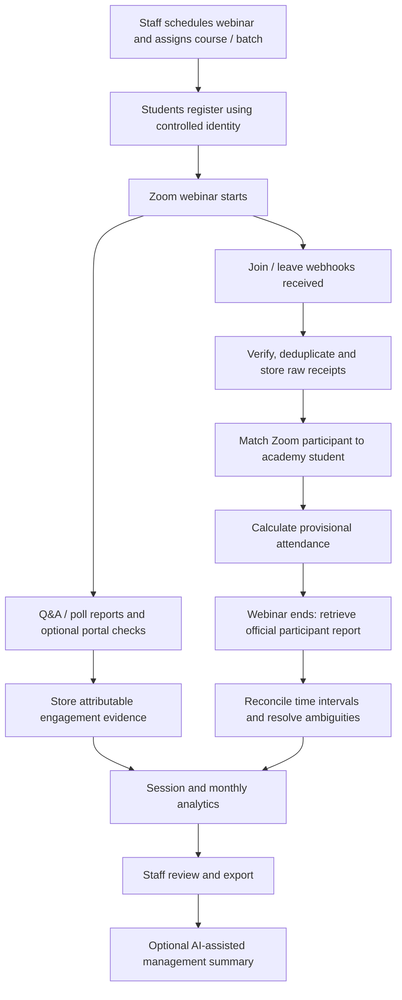
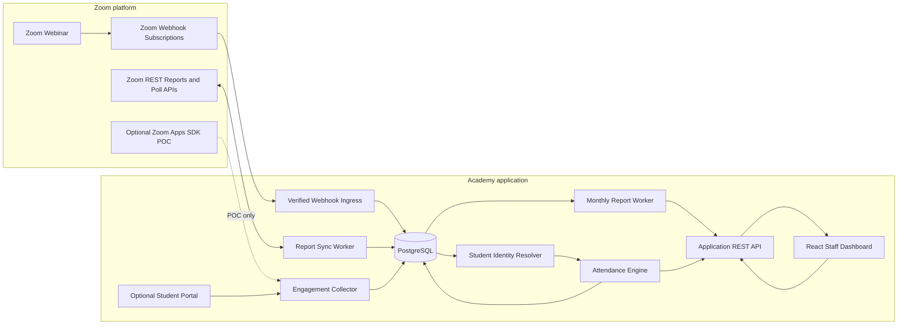

# Academy Smart Webinar Attendance & Engagement Platform

**Detailed project context, problem analysis, Zoom API research, and implementation blueprint**  
**Working title:** Smart Webinar Attendance & Engagement Management System (SWAEMS)  
**Prepared for:** IS 3610 – Management Information Systems group assignment  
**Research snapshot:** 10 November 2026  
**Status:** Proposed solution / technical research; no live academy Zoom integration or prototype is represented as completed.

> **How to read this document.** **[CONFIRMED BY ACADEMY]** reflects the team's account of its first meeting. **[VERIFIED IN ZOOM DOCUMENTATION]** identifies official documented capabilities, with numbered links in the references. **[PROPOSED DESIGN]** is a recommended solution, not a statement about the academy's existing operation. **[TO VALIDATE]** denotes a decision, permission or technical experiment still outstanding. These distinctions matter for an honest university report.

---

## Executive summary

The academy delivers teaching sessions using **Zoom Webinars**. Its staff currently **call individual student names, mark attendance manually, and check students again toward the end** to assess whether they remained involved. The academy wants to reduce the manual effort and capture **actual connection duration**, not just a one-time present/absent response. The team has also identified a desired **monthly student engagement report**—including highest interaction or reaction counts and possible **top 10 / top 100** rankings. **[CONFIRMED BY ACADEMY / TEAM DISCUSSION]**

The recommended product has three coordinated modules:

1. **Module A — Automated attendance:** ingest Zoom participant join/leave webhooks, reconcile them against official post-webinar participant reports, link sessions to registered academy students, compute time present and attendance decisions, and support supervised corrections.
2. **Module B — Engagement evidence:** collect attributable Q&A and poll participation where available; investigate whether native Zoom emoji reactions can lawfully and reliably be attributed to students through a separate Zoom Apps SDK test; if not, use an **academy-owned, authenticated engagement portal** for optional reaction buttons and learning checks.
3. **Module C — Analytics and management:** provide session dashboards, monthly summaries, raw reaction counts where defensible, top-10/top-100 rankings, trend reports, exports, and optional transparent AI-generated management summaries.

**Main feasibility decision:** A private internal Zoom integration can generally be built with **Server-to-Server OAuth** and academy admin consent **without standard public Marketplace review**. It is *not* unauthenticated public access to student records. The academy must grant appropriate scopes and hold the needed license. [Z01] [Z02] [Z03]

**Critical limitation:** Zoom's ordinary REST attendance/report endpoints do **not establish a reliably identifiable per-attendee stream of native ❤️/👍/👏 reactions**. The Zoom Apps SDK documents an `onEmojiReaction` event containing `participantUUID`, but separate Meeting SDK documentation explicitly describes anonymous webinar attendee reactions. Whether a particular host-side Zoom App can capture, identify, and map all attendees' events **must be empirically tested** before including it as a guaranteed core requirement. [Z08] [Z09] [Z10]

**Research conclusion:** Make attendance the production-ready core. Treat native emoji attribution as an experimental feature, not the dependency on which the project succeeds. Build flexible engagement analytics with a clearly labelled data source and a privacy-respecting fallback.

---

## 1. Project background and context

### 1.1 Organization and course context

- **Organization type:** local educational academy. The team states that the organization is a registered company, uses Zoom **Webinars** (not merely a conventional Zoom Meeting), and holds online classes. **[CONFIRMED BY TEAM]**
- **Unknown, not assumed:** legal entity name, business registration number, licensing tier (standard Webinars vs Webinars Plus), Zoom admin privileges, student count, monthly webinar volume, enrollment system, current fee/HR processes, retention requirements, and ability to enable webinar registration. **[TO VALIDATE]**
- **University project:** IS 3610 – Management Information Systems. The uploaded assignment calls for analysis of the organization, functional processes, existing systems and their input/process/output/user details, Porter Five Forces and Value Chain, an AI-enabled information-system proposal, knowledge management, managerial decision support, user stories, wireframes, prototype, SDLC/Agile and PM tool justification, challenges and strategic system analysis.
- **Academic output:** report of 6,000–7,000 words and 30-minute group video presentation, with organization-meeting evidence and separate meeting minutes. The stated assignment deadline is **16 November 2026, 11:55 PM**. Do not imply that a production-grade rollout is compulsory; the brief calls for a prototype.

### 1.2 What happened in the first meeting

The team reported the following workflow: the academy conducts webinars; an employee calls student names and records who responds; staff also check attendance near the end to see whether students are still participating. The academy regards this as a process that should be automated. The desired evidence includes **how long a student stayed connected** and **how much the student interacted**. A simple beginning/end poll is not sufficient as the entire attendance mechanism. The subsequent team discussion expanded the desired analytics to Q&A, polls, native emoji reactions if possible, and monthly leaderboards. **[CONFIRMED BY TEAM]**

The conversation does **not** establish that the academy approved a separate student portal, an attendance threshold, reaction-based grading, or automatic random polls; these are proposals requiring confirmation.

### 1.3 Business opportunity

**Problem owner:** academy management / attendance staff.  
**Primary users:** attendance administrators and instructors.  
**Secondary users:** directors, course coordinators and students.  
**Core value:** less clerical attendance work, repeatable evidence-based decisions, clearer reporting, and timely identification of disconnected or absent students.  
**Potential competitive advantage:** reliable online class administration, faster intervention on participation issues, more credible reporting for student services, and better capacity for increased enrollment without proportional manual work. These are **hypothesized benefits**, not measured outcomes.

---

## 2. Problem definition

### 2.1 Current-state process (AS-IS)

1. A course or batch schedules a Zoom webinar.
2. Enrolled students join, sometimes late and sometimes with unstable connectivity.
3. An attendance staff member calls names at the beginning, attempts to confirm who is connected and records attendance manually.
4. During instruction, students may ask questions, answer polls or click reactions, but these are not consistently consolidated in the academy's attendance register.
5. Near the end, the staff repeat a manual presence check.
6. Staff may need to reconcile missed students, spelling differences, reconnects and absence claims.
7. Management lacks a reliable automated monthly view of time-connected and identifiable engagement by student.

Steps 1–5 reflect the problem as described; steps 6–7 are **plausible process risks to validate** rather than reported quantified defects.

### 2.2 Problem statement (report-ready)

> The academy's current Zoom Webinar attendance procedure relies on staff calling students individually and checking their presence at multiple points during a class. This process records an intermittent indication of attendance rather than a consistent measure of each student's total connected time, and it demands manual administration. The academy also wants actionable insight into identifiable learner participation across webinars, including monthly trends and rankings. A privacy-conscious information system is therefore proposed to automate the collection and reconciliation of Zoom Webinar participation records, apply transparent attendance rules, provide verified engagement indicators and support academy staff and managers with auditable, explainable reports.

### 2.3 Root causes / hypotheses

| Issue | Current cause or hypothesis | Effect | Evidence still needed |
|---|---|---|---|
| Manual name calling | Attendance is not integrated with webinar records | Staff time spent on roll calls | Minutes consumed per class |
| Two-point presence check | No consolidated join/leave timeline in academy process | Session duration not known from register | Current spreadsheet/register sample |
| Identity mismatch | Students may use different Zoom display names | Possible incorrect attendance | Registration/name policy |
| Reconnection ambiguity | One student may create several participation segments | Under/overcount risk | Example report from Zoom |
| Engagement ambiguity | Connection, Q&A, polls and reactions are different signals | Misleading 'active student' label | Academy definition of interaction |
| Reporting fragmentation | Webinar records not linked to academy student and batch IDs | Slow monthly analysis | Current management reports |

### 2.4 Goals and measurable success criteria

The thresholds below are **proposed acceptance targets**, not academy-approved policy:

- Reduce staff time per class spent preparing and marking attendance by **at least 70%** against a measured baseline in a pilot.
- Achieve **at least 98% matching** of correctly registered pilot attendees to student records; unresolved identities appear in a review queue, never silently guessed.
- Calculate total connected time from normalized join/leave intervals with **no duplicate counting** for overlaps or reconnects.
- Produce an attendance report after session completion and Zoom report availability; show a **preliminary** live state while the webinar runs.
- Produce a monthly report filtered by batch, course, date and engagement source, including top 10 and top 100 where enough students exist.
- Keep an audit trail for all manual changes and consented processing.
- Clearly distinguish **connected** from **engaged** from **attentive**. None of these alone proves learning.

---

## 3. Scope and non-scope

### 3.1 In scope

- Authorized Zoom Webinar integration for the academy account.
- Batch/student enrollments and webinar-to-class mapping.
- Student matching using validated registrant mappings, with human review for uncertain cases.
- Near-real-time join/leave processing and post-webinar reconciliation.
- Connected-time calculation, attendance percentage, configurable policy thresholds, and reasoned overrides.
- Webinar Q&A and poll-result ingestion where identifiable and authorized.
- Optional scheduled learning checks in an authenticated academy portal; native Zoom polls can be pre-created through API.
- Separate feasible-study track for native Zoom emoji reception and attribution.
- Monthly dashboards, rankings, downloads, management summaries and access control.
- Educational prototype and high-fidelity wireframes.

### 3.2 Out of scope for the first implementation

- Proving student attention, concentration or comprehension from connected time or emoji clicks.
- Automatically reading the student's camera, microphone, screen, gaze, or third-party application activity.
- Circumventing Zoom anonymity, collecting student credentials or scraping undocumented UI/network traffic.
- Replacing Zoom itself, providing streaming infrastructure, or modifying Zoom's official service.
- Full academy ERP/accounting unless separately justified.
- Publishing a commercial multi-organization app, formal proctoring or automatic disciplinary decisions.
- Claiming native Zoom poll launching can be triggered by an ordinary documented REST call; this was **not verified** in current public API references.

---

## 4. Official Zoom capability research

### 4.1 Classification legend

- **Documented:** an official API, SDK callback or analytics feature explicitly describes the capability.
- **Conditional:** capability exists, but requires account plan, settings, scopes, role, host action or non-anonymous user data.
- **Research / proof of concept:** documentation indicates an avenue, but deployment-specific event behavior or identity mapping is not guaranteed.
- **Not established:** cannot promise it from official REST docs reviewed.

### 4.2 Feasibility matrix

| Requested capability | Zoom route | Assessment | Design consequence |
|---|---|---|---|
| Webinar join/leave timestamps | `webinar.participant_joined` / `webinar.participant_left` webhooks | **Documented / conditional** [Z04] | Live provisional attendance; signature verification and reconciliation required |
| Official past-webinar participant report | `GET /report/webinars/{webinarId}/participants` | **Documented / conditional** [Z05] | Canonical report for completed webinar; paid + Webinar add-on; six-month report lookback |
| Student connection time / reconnects | Participant join/leave records | **Derived**, not native active-time measurement | Normalize and merge intervals per identified student |
| Attendee identity | webinar registration IDs and authorized participant fields | **Conditional** [Z04] | Require registration / secure mapping, review missing identifiers |
| Webinar Q&A | `GET /past_webinars/{webinarId}/qa`, `GET /report/webinars/{webinarId}/qa` | **Documented / conditional** [Z05] | Store identifiable question records; respect anonymous questions |
| Create preconfigured poll | `POST /webinars/{webinarId}/polls` | **Documented / conditional** [Z05] | Instructor can launch prepared native Zoom polls |
| Read past poll results | `GET /past_webinars/{webinarId}/polls`; report API | **Documented / conditional** [Z05] | Only score student-specific polls when results contain valid identities; no guessing for anonymous responses |
| Automatically click “Launch” in native webinar UI | Standard Zoom REST API | **Not established** [Z05] | Do not promise unattended native launching; manual instructor action or separate portal |
| Individual native webinar emoji events via REST/webhooks | Standard Zoom REST and event references | **Not established** [Z04] [Z05] | Cannot guarantee a per-student native emoji leaderboard |
| Zoom Apps SDK emoji event | `onEmojiReaction` event with `participantUUID`, time and reaction | **Documented SDK event; webinar identity coverage uncertain** [Z08] [Z09] | Targeted pilot test with real attendee clients and roles |
| Meeting SDK webinar reaction callback | `OnEmojiReactionReceivedInWebinar(type)` | **Documented as anonymous callback** [Z10] | Strong warning against assuming attendee attribution |
| Webinars Plus reaction trend / attendee analytics | Zoom Webinars Plus analytics UI | **Conditional, product/tier-dependent** [Z11] | May inform reports, but access/export/API granularity require verification |
| Automated internal-only access | Server-to-Server OAuth | **Documented** [Z01] [Z02] | Account admin configures scopes; no general public Marketplace review |
| External cross-account publication | Marketplace distribution | **Documented review route** [Z03] | Later commercial product requires additional compliance/review |

### 4.3 Authentication, approval and access model

An internal app is not an unauthenticated public endpoint. **Server-to-Server OAuth** supplies an account-scoped bearer token after an admin creates and activates an app and selects its permitted scopes. It uses an `account_credentials` grant, an account ID, client ID and client secret. The token is valid for about one hour and is renewed by making another token request; there is no refresh token for this grant. [Z01]

**Recommended ownership:** The academy Zoom administrator owns or explicitly authorizes the app and can revoke it. The team should never ask instructors or students for Zoom passwords. The backend stores credentials only as secrets, not in a browser bundle, code repository or assignment submission. Administrators need permissions to create the app and assign requested scopes. [Z02]

**Review:** Zoom states that internal apps restricted to users within a single account do not require standard public Marketplace review; public externally distributed apps do. This removes one potential approval delay, **not** the need for academy account authorization, licensing, role permissions, webinar settings and sometimes user consent for other app types. [Z03]

### 4.4 REST endpoints and illustrative granular scopes

| Use | Method and path (relative to `https://api.zoom.us/v2`) | Example documented scope or note |
|---|---|---|
| Completed attendee report | `GET /report/webinars/{webinarId}/participants` | `report:read:list_webinar_participants:admin` |
| Q&A report | `GET /report/webinars/{webinarId}/qa` | `report:read:webinar_qna:admin` |
| Past webinar Q&A | `GET /past_webinars/{webinarId}/qa` | `webinar:read:past_qa:admin` (or appropriate user level) |
| Create native webinar poll | `POST /webinars/{webinarId}/polls` | `webinar:write:poll:admin` (or appropriate user level) |
| List configured polls | `GET /webinars/{webinarId}/polls` | `webinar:read:list_polls:admin` |
| Past poll results | `GET /past_webinars/{webinarId}/polls` | `webinar:read:list_past_polls:admin` |
| Event subscriptions | webinar join/left/ended webhook events | Configure on app with accessible HTTPS endpoint and verification |

**Technical note:** Scope names and availability depend on app/account context. Use the live Zoom app's scope picker and endpoint reference at implementation time. Store a separate **webinar UUID / instance ID** for recurring sessions; a scheduled webinar ID alone may not uniquely identify a single occurrence. Some UUID values must be encoded carefully when used in paths. [Z05] [Z12]

### 4.5 API limits, reporting windows and accuracy

Zoom documents API limits at account level, rate limit categories (LIGHT, MEDIUM, HEAVY) and HTTP **429** on exceedance; exact quotas can differ by plan. Use event-driven ingestion, cache stable data, and fetch the completed participant report once with bounded retries rather than polling a report endpoint continually. [Z06]

The participant-report endpoint documents a **six-month lookback**. The academy should store only the minimum justified derived attendance history it needs, under its own retention policy, rather than assuming Zoom will retain an API-accessible record indefinitely. Large reports may be paginated; process every returned page. [Z05]

### 4.6 Zoom's reaction identity caveat (must not be glossed over)

There are three related but non-equivalent Zoom surfaces:

1. **Standard REST / webhook APIs:** available documentation establishes join/leave, poll and Q&A data, but does not establish a standard, complete **student-ID + timestamp + native reaction** stream.
2. **Zoom Apps SDK:** `onEmojiReaction` is documented for webinar contexts, and `OnEmojiReactionEvent` declares `participantUUID`, `timestamp` and `reaction`. However, **a declared field does not guarantee that a host-app instance receives every attendee event or that its UUID can be mapped to enrollment records in the academy's account**. The webinar host is responsible for opening/inviting apps; attendee guest-mode and privacy rules apply. [Z08] [Z09] [Z13]
3. **Meeting SDK:** documentation describes a separate webinar reaction callback with only reaction type, specifically for **anonymous webinar attendee reactions**. This creates a real compatibility/privacy question that requires testing rather than optimism. [Z10]

**Additional product nuance:** Webinars Plus event analytics documents reaction-usage rates and trends; updated analytics also references reaction-count columns in attendee views. That is a **product-UI capability with specific licensing**, not proof that the ordinary webinar REST API exposes the desired personally identifiable events for independent collection. Ask the academy which Zoom plan it actually has; inspect available lawful export options before duplicating analytics. [Z11] [Z14]

**Go/no-go rule:** Unless a test demonstrates both permitted attribution and complete event delivery in the academy's actual webinar setup, the application must label native Zoom reaction rankings as **unsupported / experimental**, and use **identified custom-portal reactions** or other attributable interactions for rankings instead.

### 4.7 Native Zoom polls vs an academy-managed engagement check

- An internal app can prepare and **create** webinar polls with the documented poll creation endpoint. The instructor may then launch them from the Zoom webinar controls. [Z05]
- The reviewed public REST reference did **not show a general endpoint** to trigger a native poll's launch automatically at a chosen random minute. Absence from reviewed documentation does not prove that no other product surface exists; it means the team **must not base the MVP on it**.
- Alternative: a student portal authenticated to academy enrollment can schedule its own random low-stakes checks and store timestamps. But it cannot transparently inject those prompts into every student's Zoom native interface; a student must open the portal or a deliberately built supported in-client Zoom App.
- Anonymous Zoom poll answers cannot reliably become personal engagement scores. Require an identified response path or keep anonymous responses as **aggregate class statistics**.
- The academy previously rejected **polls alone** as a replacement for monitoring connected duration. Polls can be **supplementary**, not the only attendance evidence.

---

## 5. Future-state business process (TO-BE)



**Event sequence:** Admin assigns a class to a unique webinar instance → student joins via approved Zoom registration path → webhook receiver verifies and records events → identity matcher links attendance segments → after completion official participant data reconciles gaps → business rule computes attendance status → authorized staff review any exceptions → optional engagement evidence is added separately → monthly job aggregates results and creates rankings.

**Fallback path:** If Zoom credentials or webhook connectivity are unavailable, import an authorized CSV export from the academy's Zoom reports into a supervised upload workflow; clearly mark this as **file-based mode** rather than claiming live integration.

---

## 6. Users, permissions and use cases

| Role | Main actions | Sensitive restrictions |
|---|---|---|
| Academy director / manager | Set attendance policy, view monthly comparisons, approve exceptions | Access organizational aggregates and authorized student details |
| Attendance officer | View roster, unresolved mappings, approve attendance corrections, export reports | Corrections must include a reason; no API secret access |
| Instructor / webinar host | See own class report, prepare polls, review participation | Cannot change other instructors' classes |
| Student | View own history and optional engagement checks | Cannot view peers' personal rankings unless academy policy explicitly allows it |
| Zoom account administrator | Authorize Zoom app, configure scopes / webhook subscription | No need to access educational grading content |
| System maintainer | Monitor integrations, jobs and security logs | Minimal access; redact student PII in logs |

### Representative user stories (assignment-ready)

- **US-01:** As an attendance officer, I want a class roster matched to Zoom registrants so I do not have to call every student's name.
- **US-02:** As an attendance officer, I want the app to combine reconnects so I can see each student's total true connected minutes.
- **US-03:** As a manager, I want to set attendance thresholds by course so the same transparent policy applies consistently.
- **US-04:** As an instructor, I want a provisional attendance list during a webinar so I can see obvious connectivity issues without interrupting teaching.
- **US-05:** As an attendance officer, I want an exception queue for unknown or ambiguous Zoom names so no attendance is silently assigned to the wrong student.
- **US-06:** As an instructor, I want to create question-bank polls before class so I can conduct check-ins when I choose.
- **US-07:** As a student, I want to see my own attendance duration, policy result and reason for any missing record so I can challenge errors.
- **US-08:** As a manager, I want a top-10/top-100 monthly table broken down by interaction type and webinar count so high raw emoji counts are not confused with attendance or learning.
- **US-09:** As a director, I want an optional plain-language summary of absent/late/reconnect patterns so I can plan operational improvements.
- **US-10:** As an auditor, I want every manual attendance change linked to the staff member and reason so reports can be trusted.
- **US-11:** As a student, I want any optional engagement check to be accessible and not penalize me unfairly for slow internet or disability.
- **US-12:** As a system administrator, I want Zoom integration failures and delayed reports to be visible so staff know when results are incomplete.

---

## 7. Functional requirements

| ID | Requirement | Priority | Acceptance evidence |
|---|---|---|---|
| FR-01 | Register/import student roster and map student to batch/course | Must | Two students enrolled; correct roster shown |
| FR-02 | Register class sessions and associate Zoom webinar ID + instance UUID | Must | Two recurring sessions remain distinct |
| FR-03 | Verify inbound Zoom webhook URL validation and signatures | Must | Forged request rejected; valid request stored |
| FR-04 | Record join/leave event receipts idempotently | Must | Duplicate event does not duplicate time |
| FR-05 | Resolve student using registrant ID/approved identity mapping | Must | Ambiguous participant flagged, not assigned |
| FR-06 | Calculate interval-union connected duration and attendance percentage | Must | Rejoin test returns mathematically correct minutes |
| FR-07 | Reconcile with past webinar participant report | Must | Missed webhook recovered in final report |
| FR-08 | Apply configurable attendance policy and manual exception workflow | Must | Policy result and reason displayed; override audited |
| FR-09 | Class-level attendance dashboard, filters and export | Must | CSV report matches database figures |
| FR-10 | Monthly per-student attendance and enrollment reporting | Must | Month and batch filter tested |
| FR-11 | Import attributable webinar Q&A and poll participation | Should | Sample identifiable records appear with source label |
| FR-12 | Schedule student-portal engagement questions and store responses | Should | Authorized student response timestamp saved |
| FR-13 | Create polls via Zoom API, if account enables it | Could | Draft poll appears on webinar's poll list |
| FR-14 | Capture identifiable native Zoom emoji reactions | Research only | Real webinar pilot proves permitted attendee identity and coverage |
| FR-15 | Student-portal custom reaction buttons | Should / fallback | Reaction associated with logged-in student, class and time |
| FR-16 | Monthly top-10/top-100 reaction and interaction reports | Should | Stable ranking/tie behavior; data-source labels |
| FR-17 | Explainable AI management summary | Could | Summary grounded in numeric records, no invented metrics |
| FR-18 | Retention controls, role permissions and audit events | Must | Unauthorized report blocked; deletion tested |

### Nonfunctional requirements

- **Privacy:** minimum data necessary, purpose explanation, appropriate academy approvals, restrictions on sharing rankings, support for account-based deletion/retention.
- **Security:** TLS, server-side tokens, OAuth least privilege, webhook signature checks, redacted logs, encrypted backups, RBAC, safe export authorization, audit logging.
- **Integrity:** no duplicate event application; no overcounting overlapping join intervals; immutable raw receipts and traceable derived results.
- **Resilience:** retries with backoff for API 429/5xx, DLQ/failed-job queue, replay and final report reconciliation.
- **Performance:** scalable ingestion for class size; precomputed monthly aggregates and pagination; no need for a microservices architecture in the academic MVP.
- **Accessibility:** keyboard support, screen-reader labels and low-bandwidth option; reactions/checks are never sole proof of learning.
- **Transparency:** provisional vs finalized data states and source-of-evidence labels.

---

## 8. Attendance calculation specification

### 8.1 Essential distinctions

- **Presence duration:** the sum of unique time intervals during which Zoom reports a student connected.
- **Class duration:** configurable denominator; default planned policy is the finalized actual instructional interval, with scheduled interval also stored for audit.
- **Attendance status:** policy result, not raw Zoom fact (e.g., `PRESENT`, `BELOW_THRESHOLD`, `ABSENT`, `PENDING_REVIEW`, `EXCUSED`).
- **Engagement events:** attributable Q&A/poll/portal interactions; not continuous attentiveness.

### 8.2 Example

Class is scheduled from 14:00 to 16:00 (120 minutes). Student A connects 14:05–14:45 (40 min), disconnects 14:45–14:55, reconnects 14:55–15:50 (55 min): **95 connected minutes** and `95 / 120 × 100 = 79.17%` attendance. If the academy approves a **75%** threshold, they qualify; this rule is illustrative, not the academy's confirmed policy.

### 8.3 Algorithm

```text
input: webinar_instance, academy_student, [join, leave] raw segments
policy_window = [class_started_at, class_ended_at]  # confirmed academy policy
intervals = []
for segment in raw_segments:
    if segment cannot be linked confidently to the student: queue_for_review
    else:
        start = max(segment.join_time, policy_window.start)
        end   = min(segment.leave_time, policy_window.end)
        if end > start: intervals.append([start, end])
sort intervals by start then end
merge intervals when next.start <= current.end
connected_seconds = sum(end-start for merged intervals)
percent = 100 * connected_seconds / max(1, class_duration_seconds)
status = policy.resolve(percent, exceptions, data_completeness)
store calculation_version, underlying receipt IDs, finalized_at, status
```

**Edge cases:** duplicate webhooks; out-of-order join and leave; a missing leave; multiple devices; two concurrent sessions for one student; repeated webinar IDs; late teacher start; an early-ended class; timezone differences; canceled classes; lost connection; external attendee display names; partial post-webinar report; empty/anonymous identifiers. A participant on two devices must not automatically receive double attendance minutes. Prefer union of intervals across all sessions and explicitly review suspicious overlap.

### 8.4 Reconciliation state machine

`SCHEDULED → LIVE_PROVISIONAL → ENDED_RECONCILING → FINALIZED` with `NEEDS_REVIEW` or `SYNC_FAILED` for exceptions. A finalized attendance record can be revised only through an authorized, audited procedure. Staff must see whether values were calculated from webhooks, Zoom post-webinar report, manually verified records or simulated prototype data.

---

## 9. Engagement measurement and ranking policy

### 9.1 Recommended data-source categories

1. **Q&A** — attendee-linked questions and replies where not anonymous and accessible through authorized reports.
2. **Native Zoom polls** — responses where the academy configures non-anonymous participation and the API returns sufficient identifying fields.
3. **Native Zoom reactions** — a **research track** only; no guaranteed identifiable complete feed through core REST.
4. **Custom portal reactions** — fully attributable because a student is logged in; label them **Portal Reactions**, never “Zoom Reactions”.
5. **Academy portal learning checks** — time-stamped responses to instructor-approved questions; keep optional, accessible and tolerant of connectivity problems.

### 9.2 Report separate dimensions

For every student and month, show: enrolled classes, classes attended, total eligible class minutes, connected minutes, attendance percentage, Q&A questions, polls answered, engagement checks completed, **portal reaction count**, **verified native Zoom reaction count only if research proves it**, and sources/coverage. Display `N/A` rather than zero when a source was not collected.

**Ranking A — Most Reactions:** top 10/top 100 ordered by attributable reaction count, optionally by type. The title must state **Portal Reactions** or another verified source. Tie-breaking: count desc, classes attended desc, anonymized student identifier asc (documented and reproducible).

**Ranking B — Participation Breadth (optional):** number of sessions with at least one legitimate interaction / sessions attended. Useful to reduce incentives for repetitive spam.

**Ranking C — Attendance Consistency (optional):** average attendance percentage by month; separate from reactions and learning performance.

### 9.3 Avoid deceptive scoring

A student clicking 100 hearts is not demonstrably more attentive than a student listening silently and taking notes. Reaction totals favor devices and personalities comfortable with clicking. If the academy wants a composite `engagement_score`, make it **opt-in, explainable and never disciplinary**, cap repeated reactions, normalize by attendance opportunities, and involve teachers in design. Example *illustrative* weights: 50% attendance completeness, 25% check participation, 25% attributable Q&A/poll breadth. Do not treat such a weight as validated learning science or as an objective grade.

### 9.4 Responsible random checks

For academy-portal checks, let the instructor approve a question bank and class-time range. The scheduler can choose a random trigger within allowed windows, issue one short question with clear expiry and provide accessible alternatives. Record `issued_at`, `answered_at`, `question_id`, `class_id`, `student_id`, `result`, and `source`. Do not mark a nonresponding student absent if Zoom reports they remained connected; display **check not answered** separately.

### 9.5 Native reaction proof-of-concept plan

**Goal:** determine whether a host Zoom App running with allowed permissions can observe webinar attendee emoji events with identity values that map to enrolled students, and whether event coverage is complete.

| Test | Procedure | Expected decision evidence |
|---|---|---|
| POC-01 | Host installs/opens test Zoom App in an academy-owned test webinar | Confirm account/client/guest-mode requirements |
| POC-02 | Three consenting test attendees join from separate Zoom accounts/devices | Confirm mapping of registration IDs and attendee UUIDs |
| POC-03 | Each sends a unique known pattern of ❤️/👍/👏 | Compare observed types/counts/timestamps |
| POC-04 | Leave/rejoin; repeat reactions | Confirm stability of identifiers and deduplication |
| POC-05 | One attendee uses Zoom desktop, one web/mobile where supported | Define client/device coverage gaps |
| POC-06 | Observe reaction-event access from host vs panelist vs attendee SDK context | Determine which app instance is permitted to receive what |
| POC-07 | Turn anonymous/private settings on where allowed | Confirm no identification bypass is attempted |
| POC-08 | Compare captured counts with host-visible/Plus aggregate analytics | Verify completeness and explain differences |

**Pass:** permitted, consistent, complete attendee identifiers + correctly mapped events across supported environments. **Fail:** missing identity, unreliable delivery, only anonymous aggregate events, or privacy/role restrictions. **Outcome if fail:** disable native reaction rankings and use authenticated portal interactions.

---

## 10. Proposed logical architecture



### 10.1 Stack recommendation (not a requirement)

- **Frontend:** React + TypeScript, accessible component library, date and table filtering, charts, export controls.
- **Backend:** one modular **Spring Boot** application (Java) or Node.js/TypeScript. Choose based on group experience; modular monolith is enough for an academic MVP.
- **Database:** PostgreSQL for reliable session, receipt and reporting data.
- **Integrations:** Zoom REST and webhook handler, OAuth token manager, a report-reconciliation scheduler.
- **Deployment:** HTTPS service with environment-based secrets; local development through a tunnel only for controlled testing, or a test environment hosted with TLS.
- **Optional AI:** an auditable report-summarization component operating on derived aggregate metrics and minimizing student personal data.
- **Project management:** GitHub Projects or Trello for backlog/sprints; justify according to group size and integration complexity.

### 10.2 Components and responsibilities

1. **Zoom connector:** credentials, scoped API client, pagination, retry/backoff, response validation.
2. **Webhook ingress:** URL challenge response, signature and timestamp verification, body size limits, event receipts and nonblocking acknowledgments. [Z07]
3. **Identity resolver:** approved student/registrant mappings, ambiguous identity review, versioned resolution decisions.
4. **Session calculator:** interval-union time computation and attendance policy evaluator.
5. **Engagement collector:** Q&A, polls, optional portal and SDK research events, with per-event source evidence.
6. **Reports:** per-class snapshots, monthly aggregation, exports, ranking logic and audit trail.
7. **User service:** staff roles and student self-service visibility.
8. **Operations:** integration status, failed events, manual sync, error alerts and retention jobs.

---

## 11. Data model and integrity rules

| Entity / table | Essential fields | Constraints / purpose |
|---|---|---|
| `students` | `id`, `student_no`, `display_name`, `email?`, `active` | unique academy identifier; private data |
| `courses` | `id`, `title`, `status` | group lectures |
| `batches` | `id`, `course_id`, `name` | class cohort |
| `enrollments` | `student_id`, `batch_id`, `from_date`, `to_date?` | student belongs to a particular cohort |
| `class_sessions` | `id`, `batch_id`, `scheduled_start`, `scheduled_end`, `actual_start?`, `actual_end?`, `status` | one educational session |
| `zoom_instances` | `id`, `class_session_id`, `webinar_id`, `webinar_uuid`, `occurrence_id?` | use distinct webinar **instance** key |
| `zoom_student_links` | `id`, `student_id`, `registrant_id?`, `participant_uuid?`, `source`, `confidence`, `verified_by?` | cannot auto-link based solely on untrusted name |
| `zoom_event_receipts` | `id`, `zoom_event_key`, `kind`, `occurred_at`, `raw_minimized_payload`, `received_at` | idempotent unique key; trace source |
| `presence_segments` | `id`, `instance_id`, `student_id?`, `join_at`, `leave_at?`, `source`, `link_status` | several segments for one student; optional unresolved |
| `attendance_results` | `student_id`, `class_session_id`, `connected_seconds`, `percent`, `status`, `version`, `finalized_at?` | unique per student/session; derivation version |
| `attendance_overrides` | `result_id`, `prior_status`, `new_status`, `reason`, `actor_id`, `created_at` | append-only corrections |
| `engagement_events` | `id`, `student_id?`, `instance_id`, `type`, `source`, `occurred_at`, `external_event_key?`, `metadata` | native vs portal distinguished; no anonymous→identified guess |
| `learning_checks` | `id`, `session_id`, `question`, `open_at`, `close_at`, `status` | portal-only checks if implemented |
| `learning_check_responses` | `check_id`, `student_id`, `answered_at`, `answer_code` | one canonical response per student/check |
| `monthly_report_runs` | `month`, `batch_id?`, `calculation_version`, `created_at`, `input_coverage` | reproducible reports |
| `audit_log` | `id`, `actor`, `action`, `entity_ref`, `occurred_at`, `reason?` | no secrets in payload |

**Key constraints:** uniquely identify webhook receipts; deduplicate externally imported Q&A/poll events; never write a presence segment for an unverified student link; unique `(student_id,class_session_id)` attendance result; maintain event source and data-quality flag; use UTC timestamps for storage and the academy's selected timezone in reports; protect personal fields via access policy.

### Example derived JSON response (illustrative, not Zoom's native API schema)

```json
{
  "studentId": "STU-1042",
  "classSessionId": "CLASS-2026-11-10-A",
  "webinarInstanceStatus": "FINALIZED",
  "scheduledMinutes": 120,
  "connectedMinutes": 95,
  "attendancePercentage": 79.17,
  "attendancePolicy": { "thresholdPercentage": 75, "version": 1 },
  "status": "PRESENT",
  "engagement": {
    "identifiedQaQuestions": 2,
    "identifiedPollResponses": 1,
    "portalReactions": { "heart": 4, "clap": 1 },
    "nativeZoomEmojiReactions": null,
    "nativeZoomReactionAvailability": "UNVERIFIED"
  },
  "source": ["ZOOM_POST_WEBINAR_REPORT", "PORTAL"],
  "identityMatch": "VERIFIED_REGISTRANT"
}
```

---

## 12. Proposed application API (your API, not Zoom's API)

All endpoints below are an **application design**, not actual Zoom endpoints. Require session auth and permissions, validation, pagination and explicit error responses.

| Method / path | Consumer | Purpose |
|---|---|---|
| `POST /api/v1/integrations/zoom/webhooks` | Zoom | Validate and ingest signed event notifications |
| `GET /api/v1/integrations/zoom/health` | Admin | Last sync, scope/permission diagnostics (no secret exposure) |
| `POST /api/v1/classes` | Staff | Create a class and map webinar instance |
| `GET /api/v1/classes/{classId}/attendance` | Staff | Per-student duration, percentage, state, evidence source |
| `POST /api/v1/classes/{classId}/reconcile` | Admin | Initiate authorized post-webinar refresh job |
| `GET /api/v1/identity/unresolved` | Attendance staff | Review uncertain participant mappings |
| `POST /api/v1/identity/links` | Authorized staff | Approve mapping with justification |
| `POST /api/v1/attendance/{attendanceId}/override` | Attendance staff | Write audited correction |
| `GET /api/v1/students/me/attendance` | Student | Own attendance history only |
| `GET /api/v1/classes/{classId}/engagement` | Instructor | Per-class attributable interactions with provenance |
| `POST /api/v1/classes/{classId}/checks` | Instructor | Schedule portal engagement check |
| `POST /api/v1/checks/{checkId}/responses` | Student | Submit owned response, server validates window |
| `POST /api/v1/classes/{classId}/reactions` | Student | Optional custom portal reaction event |
| `GET /api/v1/reports/monthly?month=2026-11&batchId=...` | Manager | Monthly attendance + engagement overview |
| `GET /api/v1/leaderboards?month=...&metric=portalReactions&limit=10` | Manager | Source-labelled rankings; limit 10 or 100 |
| `GET /api/v1/reports/{runId}/export?format=csv` | Manager | Audited report export |

### Example error handling

`400` bad input/time range; `401` not authenticated; `403` wrong role; `404` resource not found or not visible; `409` duplicate/ambiguous mapping; `422` cannot finalize while mandatory source missing; `429` configured usage threshold; `503` Zoom integration temporarily unavailable. Show safe, user-friendly error text and a retry/manual-review path.

---

## 13. UI screens / wireframe inventory

The assignment requires a complete set of detailed wireframes aligned with user stories. Minimum suggested views:

1. **Login + role selection/redirect:** authorized staff/student landing experience.
2. **Manager overview:** attendance trend, sessions completed, exception count, report shortcuts.
3. **Class calendar / list:** course, batch, webinar ID, expected and actual times, sync state.
4. **Session attendance detail:** roster, join/leave timeline, minutes, percentage, status, evidence source.
5. **Student detail view:** all class sessions, reconnect visualization, Q&A/poll/portal interactions, override history.
6. **Unresolved student mapping queue:** Zoom name/email/registrant metadata permitted, candidate matches, manual assignment and audit.
7. **Attendance rules settings:** threshold, class duration denominator, grace window, exceptions, effective date.
8. **Q&A and polls evidence:** reported events labelled Zoom/anonymous/identified, filtering and caveats.
9. **Engagement check builder:** question bank, planned randomized window, response deadline, accessible alternative.
10. **Student portal reaction/check page:** simple responses and transparent notice of collection, no competitor leaderboard.
11. **Monthly analytics:** attendance distribution, reaction source switch, top 10/100, normalized engagement measures, data coverage.
12. **Report export/preview:** PDF/CSV, audience, date range, privacy warning and audit entry.
13. **Zoom connection setup:** S2S OAuth instructions, scopes, webhook health, last sync, errors; no credentials displayed in reports.
14. **Admin audit & corrections:** who changed what, when, why; review action.
15. **Prototype fallback demo mode:** conspicuous simulated-data ribbon if live account access is not available.

---

## 14. Zoom account access and integration setup checklist

**Academy confirmation:** Zoom account ownership; standard Webinar license vs Webinars Plus; webinar host identity; ability to create Server-to-Server OAuth app; permission to request `report` and `webinar` scopes; ability to enable event subscriptions; webinar registration enabled / permitted; existing Zoom Q&A and polls configuration; whether students sign into Zoom or join as guests; privacy/recording notice.

**Engineering setup:** separate development environment; Zoom admin creates S2S app and activates appropriate scopes; store credentials securely; request token and test least-privilege read API; configure HTTPS webhook endpoint; respond correctly to Zoom URL validation challenge; verify event signatures and freshness; subscribe to join/leave/ended; conduct controlled test webinar; fetch reports; validate field-level identity availability and pagination; perform end-to-end reconciliation and log failures. [Z01] [Z02] [Z04] [Z07]

**Important:** Do not copy the academy's client secret into a WhatsApp group, university report, screenshots or client-side code. For a classroom prototype, a test academy-owned Zoom account or approved supervised environment is preferable.

---

## 15. Engineering delivery phases and work breakdown

### Phase 0 — requirements and access (high priority, 0.5–1 day for assignment planning)

- Confirm webinars, plan/add-on, actual roles and data availability; obtain academy contact and approval.
- Agree on attendance policy, meaning of interaction, monthly reporting audience and whether custom portal is acceptable.
- Capture sanitized sample roster and webinar export, and prepare current-vs-future process diagrams.
- **Gate:** Can we use authentic Zoom data and identifiable registration fields? If no, use realistic synthetic sample data and flag prototype status.

### Phase 1 — attendance minimum viable prototype (2–4 development days, illustrative)

- Database entities for classes, students, enrollments, participation segments and results.
- Backend webhook receiver or simulated event input, identity mapping, interval union and attendance rules.
- Staff dashboard for session attendance, percentages and manual review states.
- Unit tests for join/rejoin/duplicates/overlaps/unknown identities.
- **Demo:** event timeline → final 95-minute/79.17% record → downloadable class report.

### Phase 2 — genuine Zoom connector and data quality (when academy authorization is available)

- S2S token integration and scoped report reader.
- Webhook URL validation, signatures, durable receipts and replay.
- Post-webinar reconciliation and finalization; UI makes freshness visible.
- **Gate:** test reports from 3–5 consenting accounts match Zoom's own UI/export within a defined tolerance.

### Phase 3 — engagement evidence (parallel after core)

- Import identifiable Q&A and poll data; record anonymous source as aggregate only.
- Create student portal (login, reactions, question checks, response timing) if academy accepts.
- Run isolated native Zoom Apps SDK emoji pilot. **Do not merge experimental event capture into production scoring until the gate passes.**
- **Demo:** interaction events displayed by type and source; no false 'attentive' label.

### Phase 4 — monthly analytics and knowledge management

- Month-by-month attendance and engagement aggregation, class/batch filters, top 10/100 by metric, CSV/PDF exports.
- Policy documentation and management dashboard (operational / tactical / strategic decisions).
- Optional AI summary grounded in computed aggregates with clear warnings and human approval.
- **Demo:** select November → view ranking → inspect how a total was calculated → export report.

### Phase 5 — verification, university deliverables, and presentation

- Run tests, validate sample figures and source citations, review privacy and accessible use.
- Draw all planned wireframes; demonstrate implemented prototype scope honestly.
- Complete university chapters and appendix (certified meeting minutes / evidence / member contribution statements).
- Explain SDLC/Agile choice and project management tool with explicit justification.
- Produce group video presentation and report before fixed submission deadline.

**Schedule caveat:** These are suggested small-slice engineering estimates, not promises that a real production deployment is possible before 16 November 2026. Prioritize a defensible academic prototype and honest feasibility evidence.

---

## 16. Test strategy and acceptance scenarios

### 16.1 Core automated tests

| ID | Scenario | Expected behavior |
|---|---|---|
| T01 | Student joins once for full class | Full eligible duration calculated |
| T02 | Student disconnects and rejoins | Both valid intervals combined; gap excluded |
| T03 | Same join webhook delivered twice | Receipt deduplicated; duration unchanged |
| T04 | Leave arrives before join | Temporarily unresolved; eventual consistent pairing |
| T05 | Overlapping device sessions | Union duration, not sum of overlapping times |
| T06 | Student attends before scheduled start | Interval clipped to academy-approved class window |
| T07 | Missing leave event | Provisional flag; report reconciliation, not invented end time |
| T08 | Zoom student name resembles two records | No automatic assignment; review queue |
| T09 | Anonymous Q&A/poll result | Aggregate only, no student-specific credit |
| T10 | 429 from Zoom | Backoff and retry; do not block class application |
| T11 | Invalid webhook signature | 4xx rejection and safe security log |
| T12 | Repeated report import | Idempotent result, no duplicate interaction count |
| T13 | Staff correct attendance | Audit trail records old/new values and reason |
| T14 | Student tries to view peer report | Access denied |
| T15 | Monthly ranking tie | Stable, documented tie handling |
| T16 | No reaction data captured | `N/A`; never invent zero native reactions |
| T17 | Session open and in progress | UI explicitly says provisional, not final |
| T18 | AI summary generated | Every number traceable to report rows; no attention diagnosis |

### 16.2 Live Zoom pilot checklist

- Run with consenting test students rather than real student records initially.
- Validate timestamps, timezone and duration against Zoom report for at least three reconnection patterns.
- Test a registrant who changes their displayed name.
- Test how participant identifiers behave for non-signed-in external attendees.
- Test recurring webinar instances and post-webinar report availability.
- Test one non-anonymous poll and one anonymous poll; compare data fields.
- Test one identifiable Q&A and one anonymous Q&A.
- Test whether emoji events can be observed and mapped through supported Zoom Apps SDK context.
- Record evidence, screenshot redactions and app/SDK version in a test log.

---

## 17. Risks, limitations and mitigations

| Risk | Likelihood / impact | Mitigation |
|---|---|---|
| No academy admin authorization | Medium / High | Synthetic prototype, supervised CSV report import, no credential sharing |
| Missing appropriate Webinar add-on/Plus analytics | Medium / High | Confirm license and feature access before sprint commitment |
| Native emoji attendee data anonymous/unavailable | High / High for emoji leaderboard | Separate POC; portal reactions fallback; clear source labels |
| Ambiguous student identity from display names | High / High | Registration-first approach, manual verification, confidence states |
| Webhook loss, duplication or reordering | Medium / High | Durable receipt table, idempotency, reconcile against official reports |
| Zoom REST limits or latency | Medium / Medium | Batching/pagination, caching, backoff, deferred sync, status display |
| Poll responses anonymous | Medium / Medium | Use aggregates or identified portal checks; no guessing |
| Artificial reaction spamming | High / Medium | Rate-limit custom reactions, measure participation breadth, no punitive raw-count score |
| Privacy of student participation histories | Medium / High | Academy policy, RBAC, consent/notice, retention, data minimization |
| Misusing engagement score as learning grade | Medium / High | Separate metrics, transparent caveats, instructor judgement, appeal process |
| AI invents conclusions | Medium / High | Structured numeric input, cite records, human review, disable if unsafe |
| Deadline too close for full production integration | High / High | Tight MVP scope, documented feasibility, synthetic demonstrator |
| Monthly report based on incomplete source coverage | Medium / Medium | Coverage labels, missing data as N/A, report audit metadata |

---

## 18. Management Information Systems analysis

### 18.1 Functional processes and information system types

**Operational level / TPS:** store class registration and attendance receipts, process webinars, save raw and normalized intervals, flag unknown participants.  
**Tactical level / MIS:** weekly/monthly reports, absence rates, reconnect patterns, cohort attendance and teacher workload insights.  
**Strategic level / DSS/ESS:** compare sustained attendance across courses and teaching schedules, detect demand or student-service gaps, decide where to invest administrative resources, and assess whether digital learning engagement supports the academy's differentiation.  
**Knowledge management:** preserved policy definitions, FAQs on attendance, exception reasons, historical reporting definitions, staff procedures and lessons learned from attendance problems.

### 18.2 Porter Five Forces questions to research (do not invent conclusions)

- Rivalry: other local academies' online delivery, class quality, support and fees.
- Threat of entrants: ease of launching online tutoring and cost of Webinar tools.
- Substitute services: recorded courses, free tutorials, in-person classes and self-study.
- Buyer bargaining power: learner switching costs, parents' expectations, demand for reliable attendance evidence.
- Supplier bargaining power: dependency on Zoom, educational content creators, payment channels and instructors.

The proposed system might differentiate the academy through reliable online student support, but the actual strategic claims need competitor and student evidence.

### 18.3 Value Chain

**Primary activities:** course marketing and enrollment → webinar delivery → instructor-student communication → attendance follow-up → examinations/certification and student support.  
**Support activities:** IT integration, staff training, administrative planning, vendor/license management, privacy and policy governance.  
**Potential efficiency improvement:** replace clerical roll calls with exception management; improve accuracy of student support and leadership reporting.

### 18.4 Competitive advantage justification

The system could support **operational excellence** (less manual marking), **service quality** (transparent records and timely support), **better decision making** (aggregated comparable reports), and **organizational learning** (historical attendance patterns). These are prospective business benefits to evaluate with the academy; they are not guaranteed results.

### 18.5 SDLC and Agile model recommendation

Use a short requirements/prototyping lifecycle with **iterative Agile delivery**. A Scrum-inspired mini-backlog or lightweight Kanban is appropriate because Zoom integration feasibility contains unresolved risks and the academic timebox is short. Separate sprint increments: (1) roster and calculations, (2) webhooks/reports, (3) engagement, (4) analytics/AI and polish. Compare this with sequential waterfall, explaining why early Zoom-reaction assumptions could invalidate a fully fixed specification. A simple **GitHub Projects** board supports task ownership, issues, progress columns and GitHub code evidence; Trello is an acceptable alternative if the team does not use GitHub.

---

## 19. AI-enabled functionality: meaningful but restrained

**AI-F01 — Monthly management narrative:** an LLM can summarize already-calculated attendance/engagement aggregates, e.g., “Batch A recorded more incomplete sessions this month; investigate connection difficulties.” Every sentence should link back to an explicit statistic and include uncertainty where coverage is missing.

**AI-F02 — Rule-based early support alerts:** simple deterministic rules first (e.g., attendance below academy-defined threshold twice in four sessions), with optional AI-assisted explanation. This is not a diagnosis of motivation or ability. Have staff review before any contact.

**AI-F03 — Common issue clustering:** group free-text *staff-authored* reasons for attendance exceptions (unstable connection, wrong registration email, class schedule conflict) into themes, with minimum sample thresholds and privacy controls.

**Not recommended:** face/gaze attention detection, emotion classification, automated penalty based on emoji counts, or inferring learning ability from reaction frequency. These are not needed to solve the initial MIS problem and would increase privacy and fairness risks.

**AI acceptance tests:** no invented percentages, reproducible prompt input and calculation provenance, visible model limitations, authorized human sign-off, removal of sensitive details before external AI processing when used.

---

## 20. Next academy meeting: validation questions

Ask these questions **before finalizing the prototype scope**:

1. Which Zoom product/license is active—regular Zoom Webinars, Zoom Webinars Plus or another Events license? Can a Zoom administrator authorize a private internal app?
2. Is registration enabled? Are students required to sign in? Do you already collect a unique student ID and registration email?
3. How many students per webinar, webinars per week, recurring webinar instances and batches are typical?
4. Does “present” mean 70%, 75%, 80%, 90% or another connected-time rule? Is the denominator scheduled class time or actual delivery time?
5. How should connectivity issues, late arrival, multiple devices and approved absences be treated?
6. What information does staff manually record today, and how many minutes does it take per session?
7. Which participation matters: Q&A, native emoji reactions, nonanonymous polls, messages, instructor-marked participation, or separate-app questions?
8. Are **native Zoom reaction buttons mandatory**, or would an optional academy-owned student portal be acceptable if Zoom does not expose identified native events?
9. Is a top 10/100 report intended for **internal staff only**? Should it rank raw reactions, sessions with interactions, or another metric?
10. May the team test the integration with consenting test students and sanitized existing reports? Who can approve access and certify findings?
11. What student privacy notice and retention policy should apply? Are some learners minors? Who approves access to personal records?
12. Can a representative review wireframes and prototype screenshots before submission?

**Recommended meeting output:** approved attendance policy; feature prioritization; valid sample roster and an anonymized Zoom export; signed/verified meeting minutes; written Zoom admin authorization plan; recorded research unknowns and fallback decisions.

---

## 21. Assumptions, decisions and research backlog

### Confirmed from the discussion

- The organization is an educational academy using Zoom **Webinars** for classes.
- It currently calls names to mark attendance and performs a later participation/presence check.
- It wants to reduce manual attendance work and capture connected duration.
- The team wants engagement reporting, including reactions and monthly top-10/top-100 style analysis.

### Still unknown / must not be represented as confirmed

- Exact account license; access to Webinars Plus and its analytics/export options.
- Which student identifiers Zoom provides in this specific account and webinar configuration.
- Whether staff will allow a separate academy student portal.
- Whether individual native emoji events are available **with reliable attendee identity** through a host-side Zoom App.
- Academy policies on attendance thresholds, scoring and student privacy.
- The number of courses, users, classes, staffing cost and actual efficiency baseline.

### Pending engineering decisions

| Decision | Proposed default | When to revisit |
|---|---|---|
| MVP centerpiece | Attendance duration and reliable identity mapping | Only after academy validation |
| App architecture | Modular monolith + PostgreSQL + React | If team expertise strongly favors other stack |
| Realtime collection | Zoom webhooks plus final reports | If admin denies webhooks |
| Native emoji rankings | **Do not promise** | Only after successful Zoom Apps SDK POC |
| Reaction fallback | Academy-authenticated portal | If academy accepts dual-screen interaction |
| Polls | Supplement attendance; host launches native poll | If verified supported in-client launch alternative exists |
| AI | Manager-reviewed aggregate narrative | If privacy or time constraints forbid it |
| Evidence | Screenshots/test logs with synthetic records | When actual academy data use is approved |

---

## 22. Final project proposition and scope statement

> **Proposed project:** Develop a web-based Smart Webinar Attendance & Engagement Management System for a local academy using Zoom Webinars. The system will connect to authorized Zoom webinar participant records, automate attendance-duration calculation with reconnect handling, associate the evidence with academy students, and provide transparent session/monthly reports. Where allowed, it will also incorporate identifiable webinar Q&A and poll records, optional academy-portal interactions, and data-quality-aware leaderboards. Because native Zoom webinar attendee emoji attribution is not reliably established through standard REST APIs, a separate technical feasibility experiment will determine whether direct reaction capture is permissible and dependable. The academic prototype will prioritize attendance accuracy, explainable calculations, privacy, user-friendly dashboards, and appropriately bounded AI-assisted management insight.

**Definition of success for IS 3610:** an evidence-backed AS-IS/TO-BE process analysis, functional and nonfunctional requirements, correctly justified Zoom feasibility matrix, management-value analysis, user stories, full wireframes and a demonstrable prototype with a transparent distinction between simulated and genuinely integrated features.

---

## 23. Research reference register

All external references below are **official Zoom documentation or Zoom Support materials**, checked in this research session on **10 November 2026**. Product behavior can change; re-check scope names and app distribution rules before deploying. The source labels in this document map to the following URLs. General API reference pages contain many endpoints; use the page search for the named operations.

- **[Z01]** Zoom Developer Docs — Server-to-Server OAuth: https://developers.zoom.us/docs/internal-apps/s2s-oauth/
- **[Z02]** Zoom Developer Docs — Internal apps and account admin permissions: https://developers.zoom.us/docs/internal-apps/
- **[Z03]** Zoom Developer Docs — App distribution, private vs externally published apps: https://developers.zoom.us/docs/distribute/
- **[Z04]** Zoom Developer Docs — Meetings/Webinars Webhooks, especially `webinar.participant_joined`, `webinar.participant_left` and `webinar.ended`: https://developers.zoom.us/docs/api/meetings/events/
- **[Z05]** Zoom Developer Docs — Meetings & Webinars REST API (webinar participant reports, polls, Q&A): https://developers.zoom.us/docs/api/meetings/
- **[Z06]** Zoom Developer Docs — API rate limits: https://developers.zoom.us/docs/api/rate-limits/
- **[Z07]** Zoom Developer Docs — Using webhooks (validation / webhook integrity): https://developers.zoom.us/docs/api/webhooks/
- **[Z08]** Zoom Apps SDK — `OnEmojiReactionEvent` type (`participantUUID`, `timestamp`, `reaction`): https://appssdk.zoom.us/types/ZoomSdkTypes.OnEmojiReactionEvent.html
- **[Z09]** Zoom Apps SDK — `onEmojiReaction` and webinar running contexts: https://appssdk.zoom.us/classes/ZoomSdk.ZoomSdk.html
- **[Z10]** Zoom Meeting SDK — Webinar emoji reactions anonymous callback: https://developers.zoom.us/docs/meeting-sdk/windows/custom-ui/basic-features/emojis/
- **[Z11]** Zoom Support — Webinars Plus event-level analytics glossary: https://support.zoom.com/hc/en/article?id=zm_kb&sysparm_article=KB0083415
- **[Z12]** Zoom Developer Docs — Granular OAuth scopes reference: https://developers.zoom.us/docs/integrations/oauth-scopes-granular/
- **[Z13]** Zoom Developer Docs — Zoom Apps for Webinars; webinar roles, guest mode and privacy requirements: https://developers.zoom.us/docs/zoom-apps/guides/webinar/
- **[Z14]** Zoom Support — Webinars Plus / Events release notes (reaction analytics coverage): https://support.zoom.com/hc/en/article?id=zm_kb&sysparm_article=KB0066826
- **[Z15]** Zoom Developer Docs — Testing Zoom Apps: https://developers.zoom.us/docs/zoom-apps/guides/testing/
- **[Z16]** Zoom Support — Using webinar reactions: https://support.zoom.com/hc/en/article?id=zm_kb&sysparm_article=KB0059395

**Academic source material referenced separately:** the group's uploaded *Group Assignment.pdf*, *Overall_Guidelines_Group_Assignment.pdf*, *Group Assignment Report Template.pdf*, *Group Assignment Presentation Template.pdf* and *Organization Meeting Minutes Template.docx*. These determine **assignment deliverables**, not Zoom product behavior.

---

## Appendix A — Short executive message to send to the academy

> Thank you for explaining the manual attendance challenges in your Zoom Webinars. Our group proposes an academic prototype that automatically calculates each registered student's connected duration (including reconnects), produces class and monthly attendance reports, and explores additional participation indicators such as webinar Q&A and polls. We are also investigating student-level Zoom reactions; this particular feature depends on Zoom's privacy rules and API/SDK capabilities, so it requires a technical test before we can promise it. We would appreciate confirmation of your Zoom Webinar license, permission for an internal API integration or anonymized sample reports, your attendance rules, and whether a small optional student engagement portal would be acceptable. We will demonstrate the planned system and collect your feedback before finalizing the assignment.

## Appendix B — Glossary

- **Webhook:** event notification that Zoom sends to the application's HTTPS endpoint when an event occurs.
- **REST API:** authenticated programmatic endpoints for fetching reports or managing webinar resources.
- **Server-to-Server OAuth:** Zoom account-level integration token flow without individual user authorization screens for each request.
- **Webinar instance/UUID:** a unique occurrence of a webinar; important when recurring webinar IDs are reused.
- **Participant / registrant ID:** Zoom-side identifiers; their presence, lifetime and linkability depend on how attendees join.
- **Presence segment:** one joined-to-left interval for an attendee; multiple may occur due to reconnects.
- **Reconciliation:** combining provisional webhook observations with the authoritative completed webinar report and resolving inconsistencies.
- **Engagement event:** an attributable participation record from an explicitly identified source, not proof of attention.
- **AI-enabled MIS:** management information system that uses AI for bounded, meaningful tasks such as summarizing validated operational measures.

